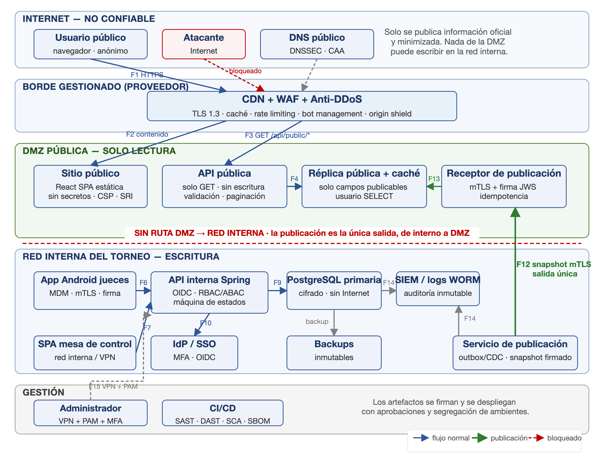
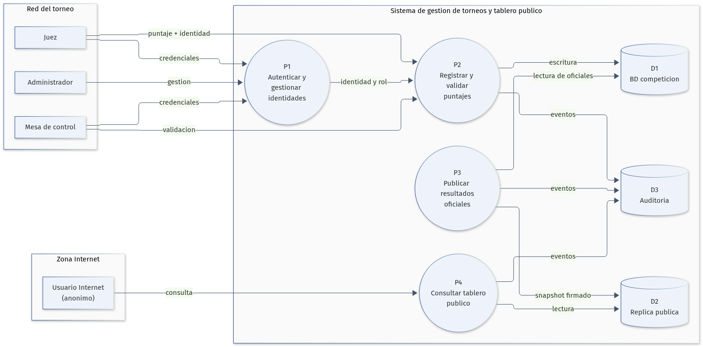
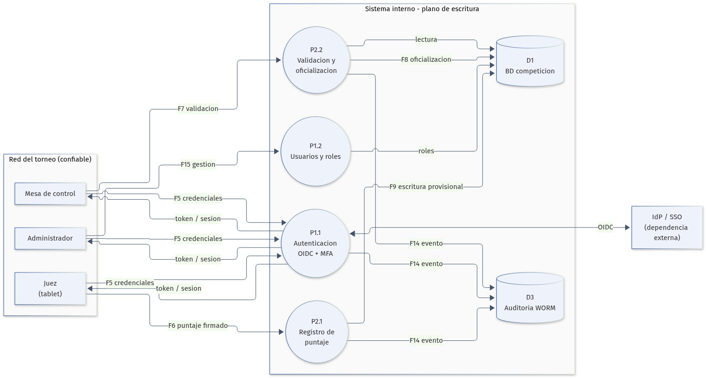
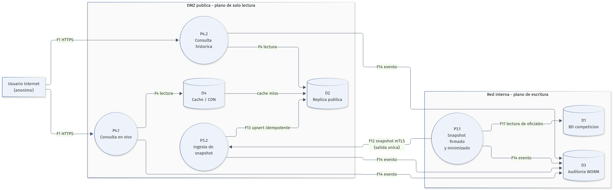

# Práctica 5: Diseño seguro

## Modelado de amenazas del tablero público de puntajes

**Curso:** Desarrollo de Software Seguro 

**Autora:** Lucía Iriarte y Ramiro Lopéz 

**Fecha:** Octubre de 2026

## Resumen 

La Federación incorpora al sistema de gestión de torneos un tablero público en Internet para consultar resultados en vivo y resultados de torneos anteriores. El cambio parece una funcionalidad de lectura, pero modifica de forma sustancial la superficie de exposición del sistema: por primera vez la aplicación queda accesible desde una red no confiable y el resultado de una competencia se convierte en información pública.

La preocupación del presidente de la Federación es que alguien desde Internet modifique una nota, se aborda en la arquitectura, no solo con controles de aplicación. La propuesta separa el lano de escritura (registro, validación y oficialización de puntajes) del plano de publicación (consulta pública). El tablero público se alimenta de una réplica de solo lectura mediante un flujo unidireccional de snapshots firmados, la DMZ pública no tiene ruta hacia la red interna, la API pública no implementa operaciones de escritura y el usuario de base de datos asociado solo puede ejecutar "SELECT". Aun si un atacante comprometiera el sitio o la API pública, no obtendría un camino directo hacia la base de competición.

El modelo de amenazas se construyó aplicando el proceso OWASP presentado en el teórico: determinar el alcance, identificar amenazas con STRIDE, definir contramedidas y evaluar el resultado. Se identificaron 20 amenazas nuevas vinculadas al tablero público y se reevaluaron 6 amenazas heredadas de la iteración anterior. Las de mayor puntaje DREAD son la exposición de datos personales en el tablero (8,6), la denegación de servicio durante el evento (8,6), la alteración de puntajes desde Internet (8,4) y la divulgación de información y elevación de privilegios (8,0). Todas las amenazas quedan con riesgo residual bajo, salvo NT-11 (DDoS), que queda en 4,2 (medio) y se acepta formalmente con condiciones, responsable y revisión posterior al evento.

El diseño propuesto permite publicar resultados en vivo sin comprometer la integridad de la competencia, protege los datos personales de gimnastas posiblemente menores de edad y mantiene la operación del torneo aun si el tablero público o la conexión a Internet fallan.

## 1. Contexto y alcance

### 1.1 El sistema y el cambio solicitado

La Federación deportiva opera un sistema de gestión de torneos analizado en el teórico. Los gimnastas se inscriben en categorías (P1 a P4 y AC1 a AC4), pueden representar a un club o competir en forma libre, y realizan una rutina en cada uno de los cuatro aparatos: viga, salto, barra y suelo. Cada rutina recibe un puntaje entre 0 y 99,999 con tres decimales.

En la versión analizada, los jueces reciben una planilla, anotan la nota y la mesa de control la ingresa en la aplicación web. La nueva versión incorpora tablets para que los jueces ingresen directamente los puntajes. La iteración anterior del modelo de amenazas identificó, entre otros riesgos, la suplantación de jueces, la modificación de puntajes, el repudio de una nota, la exposición de tokens JWT, la denegación de servicio y la elevación de privilegios por parte de la mesa de control o un administrador.

El nuevo requerimiento agrega un tablero de puntajes público en Internet:

- Cualquier persona puede acceder a una URL y ver los resultados en vivo del torneo.
- También puede consultar los resultados de torneos anteriores.
- El tablero debe ser transparente y equitativo, en línea con el principio deportivo de que cualquier interesado pueda conocer los puntajes.
- El presidente de la Federación manifestó su preocupación por que alguien desde Internet modifique la nota de un gimnasta.

El desarrollo de esta nueva versión aún no ha comenzado. Por lo tanto, el modelado de amenazas se realiza en la etapa de diseño, que es el momento de menor costo para corregir decisiones estructurales.

### 1.2 Objetivos de negocio y requisitos

| ID | Objetivo | Implicancia de seguridad |
|---|---|---|
| ON-01 | Registrar puntajes de forma precisa y trazable, reduciendo errores humanos. | Integridad, auditoría y no repudio de cada registro. |
| ON-02 | Garantizar la integridad de los puntajes, evitando manipulaciones posteriores. | Control de acceso, firmas, versionado y registro inmutable. |
| ON-03 | Proteger la confidencialidad de los datos personales de gimnastas y jueces. | Minimización, clasificación y cumplimiento de la Ley 18.331. |
| ON-04 | Asegurar la disponibilidad del sistema durante las competencias. | Resiliencia, continuidad y desacoplamiento del tablero público. |
| ON-05 | Mantener la reputación de la Federación y la transparencia del torneo. | Resultados oficiales verificables y publicación controlada. |
| ON-06 | Publicar resultados en vivo y históricos para cualquier persona en Internet. | Nueva superficie de ataque; disponibilidad y privacidad. |

Requisitos normativos y de negocio:

-Ley N.º 18.331 de Protección de Datos Personales y su decreto reglamentario: tratamiento legítimo, seguro y limitado a la finalidad de los datos de gimnastas y jueces. Los gimnastas pueden ser menores de edad, lo que exige un análisis reforzado.

-Principio de transparencia y equidad deportiva: cualquier involucrado que lo solicite debe poder conocer los puntajes de los competidores. La publicación en Internet satisface este principio, pero no habilita a publicar cualquier dato personal.

-Disponibilidad durante el evento: el tablero público no puede convertirse en una dependencia del registro de puntajes. Una caída de Internet o del sitio público no debe detener la competencia.

### 1.3 Supuestos y límites del análisis

**Supuestos**

1. El tablero publica únicamente resultados oficiales, es decir, validados por la mesa de control. La expresión “en vivo” se interpreta como una latencia objetivo menor a 60 segundos desde la oficialización, no como publicación instantánea de valores provisionales.
2. Si el negocio exige mostrar valores provisionales, se mostrarán con una marca visual y textual inequívoca y no se usarán para rankings definitivos. La recomendación de este informe es publicar solo resultados oficiales.
3. La Federación es la propietaria de las tablets de los jueces y aplica gestión de dispositivos (MDM).
4. La red WiFi de la arena es controlada por la Federación y existe un SSID exclusivo para la aplicación.
5. Los jueces, la mesa de control y los administradores se autentican; el público no se autentica.
6. La Federación contratará un proveedor de CDN, WAF y protección anti-DDoS, y utilizará un proveedor de identidad (IdP).
7. La base de competición no se expone directamente a Internet en ningún escenario.
8. Las correcciones de puntajes se realizan mediante una nueva versión o un asiento compensatorio, nunca mediante la eliminación silenciosa del registro original.
9. La publicación de resultados históricos se limita a datos deportivos y no incluye información de contacto, documentos ni datos de salud.
10. Quedan fuera de alcance las apuestas deportivas, las integraciones con terceros y el tratamiento de imágenes o videos de gimnastas.

Fuera de alcance:

-Reglamento deportivo y algoritmo de puntuación de los jueces.

-Seguridad física de la arena, más allá de la red WiFi.

-Aplicaciones de terceros que consuman los resultados (se tratarán en una iteración futura).

-Prevención de fraude deportivo o manipulación de resultados por acuerdo entre personas, que excede el diseño técnico.

### 1.4 Activos a proteger

| ID | Activo | Clasificación | Impacto si se compromete |
|---|---|---|---|
| A-01 | Puntajes oficiales y su historial de versiones. | Integridad crítica | Resultado injusto, pérdida de transparencia, acciones legales y daño reputacional. |
| A-02 | Identidades y credenciales de jueces, mesa y administradores. | Confidencial | Suplantación, carga de puntajes falsos, acceso a funciones restringidas. |
| A-03 | Datos personales de gimnastas (posiblemente menores) y jueces. | Confidencial / regulado | Sanción por la URCDP, daño a menores, pérdida de confianza. |
| A-04 | Disponibilidad del sistema durante el torneo. | Disponibilidad crítica | Suspensión del torneo, pérdida de resultados, crisis pública. |
| A-05 | Reputación y credibilidad de la Federación. | Confidencial / reputacional | Pérdida de patrocinios, cuestionamientos de equidad, renuncias. |
| A-06 | Integridad del proceso de publicación. | Integridad crítica | Difusión de resultados falsos o incompletos. |
| A-07 | Infraestructura, secretos y claves de firma. | Restringido | Compromiso total del sistema y de la cadena de publicación. |
| A-08 | Registros de auditoría. | Restringido | Imposibilidad de investigar incidentes o acreditar acciones. |
| A-09 | Disponibilidad y veracidad del tablero público. | Disponibilidad / integridad | Mala experiencia, desinformación, daño reputacional. |

### 1.5 Criterios de riesgo y umbrales

Se utiliza DREAD para priorizar, calculado como el promedio de Daño (D), Reproducibilidad (R), Explotabilidad (E), Usuarios afectados (A) y Detectabilidad (D). La escala es de 1 a 10.

| Puntaje DREAD | Prioridad | Tratamiento exigido |
|---|---|---|
| 8,0 – 10,0 | Crítica | Mitigación obligatoria antes de salir a producción. No se acepta sin aprobación del dueño del negocio y del responsable de seguridad. |
| 7,0 – 7,9 | Alta | Mitigación obligatoria; puede aceptarse residual medio con plan y fecha. |
| 5,5 – 6,9 | Media | Mitigación planificada; seguimiento en el backlog. |
| Menor a 5,5 | Baja | Se acepta o se monitorea. |

Umbral de riesgo residual: se considera aceptable un residual menor o igual a 3,9 (bajo). Un residual entre 4,0 y 5,9 (medio) requiere aceptación formal del dueño del proceso de negocio, con justificación, compensaciones y fecha de revisión. Un residual mayor o igual a 6,0 (alto) impide la salida a producción.

DREAD es una herramienta de priorización y no una medida absoluta de probabilidad. Se complementa con el contexto del negocio, el valor del activo y los controles compensatorios existentes.

---

## 2. Entregable I — Arquitectura propuesta

### 2.1 Vista de arquitectura

**Figura 1.** Arquitectura propuesta. El plano de escritura permanece en la red interna; el plano de lectura pública se despliega en una DMZ sin ruta hacia la red interna. La publicación es un flujo unidireccional de snapshots firmados.

La arquitectura mantiene el tablero público como un **producto de datos derivado**, no como una vista directa de la base de competición. Esto es lo que responde estructuralmente a la preocupación del presidente: desde Internet no existe una ruta de escritura hacia los puntajes, ni siquiera si un atacante compromete el sitio público.

### 2.2 Principios de diseño seguro

1. **Separación de planos:** el plano de escritura (competición) y el plano de lectura pública (tablero) son independientes en red, cómputo, base de datos y credenciales.
2. **Flujo unidireccional:** los resultados viajan desde la red interna hacia la DMZ; la DMZ nunca inicia conexiones hacia la red interna.
3. **Mínimo privilegio y denegación por defecto:** cada componente y cada usuario tiene solo los permisos necesarios; toda ruta no declarada se deniega.
4. **No confiar en la red:** el acceso de operadores se autentica y autoriza en cada solicitud, incluso dentro de la red del torneo.
5. **Minimización de datos públicos:** el tablero publica solo campos deportivos necesarios; los datos personales sensibles nunca salen del plano interno.
6. **Integridad verificable y no repudio:** cada puntaje y cada snapshot de publicación tienen identidad, sello de tiempo, firma y registro de auditoría inmutable.
7. **Disponibilidad del scoring independiente del tablero:** una falla de Internet, del CDN o del sitio público no afecta el registro de puntajes.
8. **Defensa en profundidad:** controles en el borde, la red, la aplicación, los datos, la identidad y la operación.
9. **Seguridad por diseño y por defecto:** la configuración inicial es la segura; las funciones peligrosas no se habilitan por conveniencia.
10. **Observabilidad y mejora continua:** logs, métricas, alertas y revisión periódica del modelo de amenazas.

### 2.3 Componentes y responsabilidades

| Componente | Zona | Responsabilidad | Controles principales |
|---|---|---|---|
| CDN + WAF + Anti-DDoS | Borde del proveedor | Terminación TLS, caché, filtrado de tráfico malicioso, mitigación DDoS. | TLS 1.3, WAF con OWASP CRS, rate limiting, bot management, origin shield, autenticación de origen. |
| Sitio público (React SPA estática) | DMZ | Interfaz de consulta para el público. | Sin secretos, CSP estricta, SRI, source maps deshabilitados, build inmutable, cabeceras de seguridad. |
| API pública | DMZ | Consulta de resultados en vivo e históricos. | Solo `GET`, validación de esquema, paginación, ETag, errores genéricos, rol de base de datos `SELECT` únicamente. |
| Réplica pública / caché | DMZ | Almacena exclusivamente los datos publicables. | Solo datos derivados y minimizados, sin PII sensible, sin credenciales de escritura, refresco idempotente. |
| Receptor de publicación | DMZ | Recibe y valida los snapshots del publicador. | mTLS, verificación de firma JWS, control de secuencia y frescura, idempotencia, auditoría. |
| Servicio de publicación | Red interna | Lee resultados oficiales, minimiza, agrega y firma snapshots. | Outbox/CDC, whitelist de campos, firma Ed25519, salida únicamente, reintentos idempotentes. |
| API interna (Spring) | Red interna | Registro, validación y oficialización de puntajes. | OIDC, RBAC/ABAC, validación de rango, idempotencia, máquina de estados, auditoría. |
| IdP / SSO | Red interna | Autenticación de jueces, mesa y administradores. | OIDC, MFA, tokens de corta duración, claims de dispositivo, políticas de acceso condicional. |
| PostgreSQL primaria | Red interna | Fuente de verdad de la competición. | Subred privada, cifrado en reposo, sin Internet, usuarios de mínimo privilegio, backups. |
| App Android de jueces | Red del torneo | Ingreso de puntajes desde tablets. | MDM, certificado de dispositivo/mTLS, certificate pinning, cola offline cifrada, sin logs de puntajes, borrado remoto. |
| SPA de mesa de control | Red interna | Validación y oficialización de puntajes. | Acceso solo desde red interna/VPN, OIDC, MFA, RBAC, sesión corta. |
| Consola de administración | Red de gestión | Administración de usuarios, roles y configuración. | VPN, PAM, MFA, acceso just-in-time, lista de IP permitidas, sin exposición a Internet. |
| SIEM / logs WORM | Red interna | Centralización y retención inmutable de auditoría. | Hash chain, WORM, alertas, retención, control de acceso. |
| Backups | Cuenta/región separada | Recuperación ante desastre. | Cifrado, inmutabilidad (object lock), pruebas de restauración, acceso separado. |
| KMS / Secrets Manager | Red de gestión | Custodia de claves y secretos. | Rotación, auditoría, acceso por rol, credenciales efímeras. |
| CI/CD | Red de gestión | Construcción y despliegue seguro. | SAST, DAST, SCA, SBOM, artefactos firmados, IaC scanning, aprobaciones. |

### 2.4 Zonas de confianza y segmentación de red

| Zona | Nivel de confianza | Contenido | Reglas de comunicación |
|---|---|---|---|
| Internet | No confiable | Usuarios públicos, atacantes, DNS público. | Solo HTTPS 443 hacia el CDN. Sin acceso directo a DMZ ni a red interna. |
| Borde gestionado | Semi-confiable (proveedor) | CDN, WAF, anti-DDoS. | Hacia el origen solo con autenticación de origen; purgas firmadas; MFA en el panel del proveedor. |
| DMZ pública | Baja | Sitio, API pública, réplica, receptor de publicación. | Sin ruta hacia la red interna. Salida a Internet restringida. Solo recibe publicación desde el publicador interno. |
| Red interna del torneo | Alta | API interna, IdP, base primaria, publicador, SIEM. | Acceso desde la red del torneo o VPN; nunca desde Internet ni desde la DMZ. |
| Red de gestión | Alta | VPN, PAM, CI/CD, KMS, administración. | Acceso separado, MFA, just-in-time, registro de sesiones. |

**Reglas de firewall relevantes**

- `Internet → CDN`: 443/TCP únicamente.
- `CDN → DMZ`: 443/TCP con autenticación de origen (mTLS o cabecera firmada).
- `DMZ → Internet`: solo actualizaciones, OCSP y NTP; sin acceso a la red interna.
- `DMZ → Red interna`: **denegado por completo**.
- `Red interna → DMZ`: solo el servicio de publicación, 443/TCP, mTLS, salida unidireccional.
- `Red de gestión → Red interna`: VPN + PAM, puertos administrativos específicos, MFA.
- `Red interna → Internet`: solo a través de proxy de salida con allowlist.

### 2.5 Dependencias externas

| ID | Dependencia | Descripción | Control esperado |
|---|---|---|---|
| DE-01 | Proveedor CDN/WAF/Anti-DDoS | Borde de Internet, caché y mitigación DDoS. | Contrato con SLA, MFA, registro de cambios, origin shield, revisión de configuración. |
| DE-02 | DNS público y autoridad certificadora | Resolución y certificados TLS. | DNSSEC, CAA, registrar lock, MFA en el registrador, monitoreo de Certificate Transparency. |
| DE-03 | Internet / ISP de la arena | Conectividad del público y de la red del torneo. | Enlaces redundantes, monitoreo, plan de contingencia. |
| DE-04 | IdP / SSO | Autenticación de operadores. | OIDC, MFA, políticas de acceso condicional, revisión de accesos. |
| DE-05 | PostgreSQL | Motor de base de datos. | Versión soportada, parches, cifrado, backups, monitoreo. |
| DE-06 | Tablets Android y MDM | Dispositivos de los jueces. | MDM, cifrado, bloqueo, borrado remoto, inventario, actualizaciones. |
| DE-07 | KMS / Secrets Manager | Custodia de claves y secretos. | Rotación, separación de funciones, auditoría. |
| DE-08 | SIEM / almacenamiento WORM | Auditoría y detección. | Retención, inmutabilidad, alertas, control de acceso. |
| DE-09 | CI/CD y registro de artefactos | Construcción y despliegue. | SAST/DAST/SCA, SBOM, firma, aprobaciones, segregación de ambientes. |
| DE-10 | Almacenamiento de backups | Recuperación. | Cifrado, inmutabilidad, cuenta separada, pruebas de restauración. |

### 2.6 Puntos de entrada y niveles de confianza

| ID | Punto de entrada | Descripción | Protocolo / autenticación | Nivel de confianza |
|---|---|---|---|---|
| EP-01 | HTTPS público | URL del tablero público. | HTTPS 443; anónimo. | N0 |
| EP-02 | API pública | Endpoints `/api/public/*`. | HTTPS; solo `GET`; anónimo. | N0 |
| EP-03 | Sitio estático | Recursos del front público. | HTTPS; anónimo. | N0 |
| EP-04 | API interna | Endpoints de registro y administración. | HTTPS + OIDC + mTLS; jueces, mesa, admin. | N2, N3, N4 |
| EP-05 | App Android | Aplicación de jueces. | mTLS + OIDC + firma de dispositivo. | N2 |
| EP-06 | SPA de mesa de control | Validación y oficialización. | OIDC + MFA; solo red interna/VPN. | N3 |
| EP-07 | Consola de administración | Gestión de usuarios, roles y configuración. | VPN + PAM + MFA + JIT. | N4 |
| EP-08 | Ingesta de publicación | Recepción de snapshots. | mTLS + JWS; solo red interna. | N5 |
| EP-09 | CI/CD | Despliegue de artefactos. | OIDC federado, aprobaciones, artefactos firmados. | N5 |
| EP-10 | Monitoreo / SIEM | Recolección de logs y métricas. | mTLS, credenciales de servicio. | N5 |

| Nivel | Nombre | Descripción |
|---|---|---|
| N0 | Anónimo Internet | Cualquier persona o bot en Internet, sin autenticación y sin relación con la Federación. |
| N1 | Anónimo red local | Persona conectada a la WiFi de la arena, sin autenticación. Se usa solo como referencia; el tablero público no requiere este nivel. |
| N2 | Juez | Usuario autenticado que evalúa rutinas e ingresa puntajes de los aparatos que tiene asignados. |
| N3 | Mesa de control | Usuario que valida, corrige y oficializa puntajes. |
| N4 | Administrador | Usuario con acceso a la configuración y gestión de identidades. |
| N5 | Servicio | Identidad de servicio para publicación, monitoreo o despliegue. |

### 2.7 Flujo de publicación de resultados

**Paso a paso**

1. El juez se autentica en la app con OIDC + MFA y el certificado del dispositivo. El token es de corta duración y está ligado al dispositivo.
2. El juez ingresa el puntaje. La app valida el rango 0–99,999, agrega un identificador de idempotencia y firma la solicitud con la clave del dispositivo.
3. La API interna verifica la firma, el token, el rol y la asignación del juez al torneo y al aparato. Registra el puntaje como **provisional** y emite un evento de auditoría.
4. La mesa de control revisa el puntaje. Si corresponde, lo oficializa; si hay un error, genera una nueva versión con motivo y doble control. Nunca se borra el registro anterior.
5. El servicio de publicación lee los resultados oficiales mediante outbox/CDC, aplica la whitelist de campos, calcula el ranking y firma un snapshot con Ed25519.
6. El snapshot viaja por mTLS al receptor de la DMZ. El receptor verifica firma, esquema, secuencia, sello de tiempo y frescura; rechaza duplicados y replay.
7. El receptor actualiza la réplica pública de forma idempotente y audita el evento.
8. El usuario consulta el tablero a través del CDN/WAF. La API pública responde solo con campos públicos y oficiales. Si la réplica está desactualizada, se muestra la marca de “última actualización” en lugar de datos inventados.

### 2.8 Decisiones de diseño y trade-offs

| Decisión | Alternativa descartada | Justificación | Costo / trade-off |
|---|---|---|---|
| Réplica pública separada y solo lectura. | Exponer la base de competición con un usuario de solo lectura. | Elimina el camino directo a la base primaria y permite publicar solo datos minimizados. | Mayor complejidad de replicación y costo de infraestructura. |
| Publicación unidireccional firmada. | La DMZ consulta la API interna. | Evita que un compromiso de la DMZ se convierta en un pivote hacia la red interna. | Latencia de publicación y necesidad de manejar reintentos e idempotencia. |
| Publicar solo resultados oficiales. | Publicar cada puntaje apenas se ingresa. | Protege la integridad y la reputación; evita difundir errores. | Menor inmediatez; requiere explicar la semántica de “en vivo”. |
| mTLS + certificado de dispositivo para jueces. | Solo usuario y contraseña o solo JWT. | Ata el token al dispositivo autorizado y dificulta el uso de credenciales robadas. | Complejidad operativa de MDM y rotación de certificados. |
| MFA para jueces y mesa. | Solo contraseña. | Reduce suplantación y credential stuffing. | Fricción en el ingreso; requiere capacitación y códigos de respaldo. |
| Minimización de datos públicos. | Publicar toda la ficha del gimnasta. | Cumple Ley 18.331 y reduce el impacto de una fuga. | Menor riqueza informativa para el público. |
| CDN/WAF gestionado. | Infraestructura propia en la arena. | Absorbe DDoS y descarga la operación del evento. | Dependencia de un tercero y costo recurrente. |
| Administración por VPN + PAM. | Panel de administración accesible por Internet. | Elimina una superficie de ataque crítica. | Menos comodidad para administradores; requiere procesos. |
| Tablero público desacoplado. | Compartir clúster con la API interna. | La caída o la carga del tablero no afecta el registro de puntajes. | Duplicación de infraestructura y observabilidad. |

### 2.9 Requisitos de seguridad derivados

| ID | Requisito | Prioridad | Verificación |
|---|---|---|---|
| RS-01 | La API pública no debe exponer métodos de escritura. | Must | Inventario de rutas, pruebas de verbos y DAST. |
| RS-02 | El usuario de base de datos de la API pública solo puede ejecutar `SELECT`. | Must | Prueba de permisos y revisión de configuración. |
| RS-03 | No debe existir ruta de red desde la DMZ hacia la red interna. | Must | Revisión de security groups, firewall y prueba de conectividad. |
| RS-04 | Cada snapshot debe estar firmado y verificarse antes de publicarse. | Must | Prueba de tamper y replay. |
| RS-05 | Jueces, mesa y administradores deben usar MFA. | Must | Prueba de autenticación y revisión de políticas del IdP. |
| RS-06 | Los tokens deben ser de corta duración y estar ligados al dispositivo. | Must | Prueba de expiración, revocación y reutilización. |
| RS-07 | La autorización debe validarse en el servidor por rol y por objeto. | Must | Pruebas de IDOR/BOLA y revisión de código. |
| RS-08 | Toda modificación de puntaje debe quedar en auditoría inmutable. | Must | Prueba de escritura, borrado y verificación de hash. |
| RS-09 | El tablero solo debe publicar campos de la whitelist aprobada. | Must | Prueba de contrato de API y revisión de datos. |
| RS-10 | Todo el tráfico debe usar TLS 1.2+ (preferentemente 1.3) y HSTS. | Must | Escaneo TLS y revisión de cabeceras. |
| RS-11 | El borde debe aplicar WAF, rate limiting y mitigación DDoS. | Must | Prueba de carga y revisión de configuración. |
| RS-12 | Los errores no deben revelar stack traces, rutas internas ni secretos. | Must | Pruebas de error y revisión de respuestas. |
| RS-13 | Los secretos deben gestionarse en un vault y rotarse. | Must | Escaneo de repositorios, imágenes y logs. |
| RS-14 | El pipeline debe incluir SAST, DAST, SCA y SBOM. | Should | Evidencia de pipeline y revisión de hallazgos. |
| RS-15 | Los backups deben ser inmutables y probarse periódicamente. | Must | Simulacro de restauración. |
| RS-16 | La caída del tablero público no debe afectar el registro de puntajes. | Must | Prueba de caos y revisión de arquitectura. |
| RS-17 | Se debe realizar una evaluación de impacto en privacidad. | Must | Documento aprobado por el responsable de privacidad. |
| RS-18 | Debe existir un runbook de respuesta a incidentes y contacto 24/7. | Should | Simulacro y revisión de contactos. |

---

## 3. Entregable II — Paso 1: Determinar el alcance

### 3.1 Proceso OWASP aplicado

Se aplica el proceso de cuatro pasos presentado en el teórico:

1. **Determinar el alcance:** describir el sistema, el nuevo requerimiento, los activos, las dependencias, los puntos de entrada, los niveles de confianza y los DFD.
2. **Determinar amenazas:** analizar cada componente y flujo con STRIDE, describir escenarios y calcular DREAD.
3. **Determinar contramedidas y mitigaciones:** elegir el tratamiento (aceptar, eliminar, mitigar, transferir), definir controles y estimar el riesgo residual.
4. **Evaluar el análisis:** verificar si quedan riesgos por encima del umbral, documentar excepciones y planificar la siguiente iteración.

Este documento constituye la **segunda iteración** del modelo: la primera cubrió el sistema de gestión de torneos con tablets para jueces; esta incorpora el tablero público en Internet y revisa las amenazas heredadas a la luz de la nueva exposición.

### 3.2 DFD nivel 1

**Figura 2.** DFD nivel 1. Se incorporan los procesos de publicación y consulta pública, y la réplica pública como almacén separado de la base de competición.

### 3.3 DFD nivel 2: registro y validación de puntajes

**Figura 3.** DFD nivel 2 del plano de escritura. La autenticación, el registro y la oficialización ocurren en la red interna; la mesa de control valida antes de que un resultado pueda publicarse.

### 3.4 DFD nivel 2: publicación y consulta

**Figura 4.** DFD nivel 2 del plano de lectura. El publicador envía un snapshot firmado a la DMZ; la consulta pública solo lee la réplica y la caché.

### 3.5 Flujos y niveles de confianza

| ID | Origen → Destino | Datos | Protección | Cruza frontera |
|---|---|---|---|---|
| F1 | Usuario Internet → CDN | Solicitud HTTPS de consulta. | TLS 1.3, WAF, rate limiting. | Internet → borde |
| F2 | CDN → Sitio público | Contenido estático. | TLS, autenticación de origen. | Borde → DMZ |
| F3 | CDN / front → API pública | `GET /api/public/*`. | TLS, validación de esquema. | Borde → DMZ |
| F4 | API pública → réplica/caché | Consulta `SELECT`. | Rol de solo lectura, red privada de DMZ. | Interno de DMZ |
| F5 | Juez / mesa / admin → IdP | Credenciales y MFA. | OIDC, TLS, MFA. | Red del torneo → IdP |
| F6 | App del juez → API interna | Puntaje, Token JWT, firma del dispositivo. | mTLS, JWT corto, firma, idempotencia. | Red del torneo → interna |
| F7 | SPA de mesa → API interna | Validación y oficialización. | OIDC, MFA, mTLS, RBAC. | Red interna |
| F8 | API interna → BD primaria | Escritura de puntaje y versión. | TLS, usuario de mínimo privilegio, transacción. | Red interna |
| F9 | API interna → BD primaria | Lectura para validación. | TLS, usuario de lectura. | Red interna |
| F10 | API interna ↔ IdP | Validación de token y claims. | OIDC, TLS, cache de JWKS. | Red interna |
| F11 | Publicador → BD primaria | Lectura de resultados oficiales. | Usuario de solo lectura, outbox/CDC. | Red interna |
| F12 | Publicador → receptor DMZ | Snapshot firmado. | mTLS, JWS, secuencia, timestamp. | Interna → DMZ (salida única) |
| F13 | Receptor → réplica pública | Upsert idempotente. | Red privada de DMZ, credencial de escritura limitada. | Interno de DMZ |
| F14 | Componentes → SIEM | Eventos de auditoría. | mTLS, hash chain, retención WORM. | Hacia red interna |
| F15 | Administrador → API interna | Gestión de usuarios y configuración. | VPN, PAM, MFA, JIT. | Gestión → interna |
| F16 | CI/CD → componentes | Artefactos y configuraciones. | OIDC federado, firma, aprobaciones. | Gestión → interna/DMZ |
| F17 | BD primaria → backups | Copia cifrada. | Cifrado, inmutabilidad, cuenta separada. | Interna → almacenamiento |

---

## 4. Paso 2: Determinar amenazas

### 4.1 Método

Para cada elemento y flujo del DFD se aplicaron las seis categorías STRIDE:

- **S — Spoofing:** suplantación de identidad de usuario, dispositivo o servicio.
- **T — Tampering:** alteración no autorizada de datos, código o configuraciones.
- **R — Repudiation:** negación de una acción sin evidencia que la contradiga.
- **I — Information Disclosure:** exposición de información a quien no debe acceder.
- **D — Denial of Service:** interrupción o degradación de la disponibilidad.
- **E — Elevation of Privilege:** obtención de permisos superiores a los autorizados.

Cada amenaza se puntúa con DREAD y se clasifica según la tabla de la sección 1.5. Las amenazas nuevas se identifican con el prefijo `NT`; las heredadas, con `HR`.

### 4.2 Amenazas del nuevo requerimiento

| ID | STRIDE | Amenaza / escenario | Elemento o flujo | D/R/E/A/D | Puntaje | Prioridad |
|---|---|---|---|---|---|---|
| NT-01 | T | Un atacante desde Internet intenta escribir o alterar un puntaje usando la superficie pública: prueba `PUT/PATCH/DELETE`, manipula identificadores, aprovecha mass assignment o una inyección en filtros de la API pública. | EP-02, F3, F4 | 10/8/6/10/8 | 8,4 | Crítica |
| NT-02 | T | Envenenamiento de caché o compromiso de una cuenta del proveedor CDN para mostrar resultados falsos o alterar los publicados. | CDN, F2, F3 | 9/6/4/10/5 | 6,8 | Media |
| NT-03 | T | Alteración del snapshot en tránsito entre el publicador interno y el receptor de la DMZ mediante MITM, replay o reemplazo del mensaje. | F12 | 9/5/4/10/5 | 6,6 | Media |
| NT-04 | T | Publicación de resultados provisionales o no validados, difundiendo un error o una manipulación como si fuera oficial. | F11, F12, F13 | 7/8/6/10/7 | 7,6 | Alta |
| NT-05 | S | Suplantación del sitio público mediante secuestro de DNS, typosquatting o phishing para difundir resultados falsos o robar credenciales de jueces. | DNS, CDN, EP-01 | 8/5/5/10/6 | 6,8 | Media |
| NT-06 | S | Suplantación de un juez con credenciales robadas o obtenidas por phishing desde Internet. | F5, F6, EP-04 | 10/7/6/8/7 | 7,6 | Alta |
| NT-07 | S | Un servicio malicioso se presenta ante el receptor de la DMZ como el publicador legítimo y envía snapshots falsos. | EP-08, F12 | 9/5/4/10/5 | 6,6 | Media |
| NT-08 | I | Exposición de datos personales de gimnastas —posiblemente menores— o de jueces en el tablero: nombres completos, documentos, fechas de nacimiento, contactos, escuela o datos de salud. | EP-02, F4 | 8/10/9/10/6 | 8,6 | Crítica |
| NT-09 | I | Divulgación de información interna por errores verbosos, source maps, Actuator/Swagger expuestos, metadatos, identificadores internos o endpoints de administración. | Sitio público, API pública | 7/8/8/10/7 | 8,0 | Crítica |
| NT-10 | I | Scraping o enumeración masiva de resultados históricos y construcción de perfiles de gimnastas. | EP-02, F1, F4 | 2/10/10/6/10 | 7,6 | Alta |
| NT-11 | D | DDoS o HTTP flood contra el tablero público durante una competencia, afectando la disponibilidad y la reputación. | CDN, EP-01, EP-02 | 5/9/9/10/10 | 8,6 | Crítica |
| NT-12 | D | Agotamiento de recursos mediante paginación abusiva, ordenamientos costosos, búsquedas con comodines o exportaciones masivas en la API pública. | API pública, F4 | 3/10/10/7/9 | 7,8 | Alta |
| NT-13 | D | Pivote desde la DMZ comprometida hacia la red interna para afectar el registro de puntajes. | Segmentación DMZ/interna | 10/4/3/10/4 | 6,2 | Media |
| NT-14 | E | Elevación de privilegios desde anónimo a juez, mesa o administrador por validación deficiente de JWT, roles en el cliente, IDOR/BOLA o mass assignment. | API pública, API interna | 9/7/6/10/8 | 8,0 | Crítica |
| NT-15 | E | Compromiso del publicador o del receptor permite escribir en la réplica o usar la DMZ como puente hacia la red interna. | F12, F13 | 10/4/3/10/4 | 6,2 | Media |
| NT-16 | E | Cadena de suministro comprometida: dependencia npm/Maven, imagen base o JavaScript de terceros que ejecuta código en el front o en la API. | CI/CD, front, API | 10/5/4/10/6 | 7,0 | Alta |
| NT-17 | R | Un juez, la mesa o un operador niega haber registrado, corregido o publicado un resultado, sin evidencia suficiente para acreditarlo. | F6, F7, F12, F14 | 7/7/5/6/4 | 5,8 | Media |
| NT-18 | E | Consola de administración expuesta a Internet, sujeta a fuerza bruta, credential stuffing o explotación de vulnerabilidades. | EP-07 | 10/6/5/10/7 | 7,6 | Alta |
| NT-19 | I | Fuga de secretos —claves de base de datos, del CDN o de firma— en repositorios, imágenes, front o logs de CI. | CI/CD, KMS, front | 9/7/6/10/6 | 7,6 | Alta |
| NT-20 | D | Acoplamiento entre el tablero público y el registro de puntajes: la caída o la carga del tablero afecta la operación del torneo. | Arquitectura, F4, F8 | 10/5/4/10/4 | 6,6 | Media |

### 4.3 Reevaluación de amenazas heredadas

| ID | Amenaza heredada | DREAD (previo → revisado) | Efecto del nuevo requerimiento | Control adicional | Residual |
|---|---|---|---|---|---|
| HR-01 | Un atacante intenta iniciar sesión como un juez. | 8,2 → 8,6 | Aumenta la superficie: ahora hay intentos desde Internet y más valor en el tablero público. | MFA resistente a phishing, certificado de dispositivo, acceso condicional, bloqueo y monitoreo. | 2,4 |
| HR-02 | Un atacante o insider modifica un puntaje. | 6,8 → 6,8 | Se mantiene; el tablero público no escribe, pero aumenta el incentivo reputacional. | RBAC, separación de funciones, doble control, auditoría y revisión. | 2,8 |
| HR-03 | Un juez no reconoce el puntaje como suyo. | 6,8 → 6,8 | Se mantiene; la publicación hace más visible el resultado y el reclamo. | Firma de dispositivo, identidad, sello de tiempo y auditoría WORM. | 2,4 |
| HR-04 | Un atacante visualiza un token JWT. | 8,6 → 8,6 | Se mantiene o aumenta por el uso de tablets y la exposición del ecosistema. | Tokens cortos, refresh rotation, mTLS, pinning, no logs y revocación. | 2,8 |
| HR-05 | Un atacante envía miles de pedidos al servicio REST. | 6,0 → 5,2 | Disminuye para la API interna porque no está expuesta a Internet; el DDoS se absorbe en el borde. | Rate limiting, WAF, cuotas y monitoreo. | 3,2 |
| HR-06 | El administrador o la mesa de control ingresan un puntaje. | 6,2 → 6,2 | Se mantiene; la publicación agrega presión sobre la trazabilidad. | RBAC/ABAC, separación de funciones, auditoría y revisión de permisos. | 2,6 |

### 4.4 Ranking de amenazas

| # | ID | Amenaza | DREAD | Prioridad | Tratamiento |
|---|---|---|---|---|---|
| 1 | NT-08 | Exposición de datos personales en el tablero público. | 8,6 | Crítica | Mitigar |
| 2 | NT-11 | DDoS o HTTP flood contra el tablero. | 8,6 | Crítica | Mitigar / transferir |
| 3 | HR-01 | Suplantación de juez. | 8,6 | Crítica | Mitigar |
| 4 | HR-04 | Visualización de token JWT. | 8,6 | Crítica | Mitigar |
| 5 | NT-01 | Alteración de puntajes desde la superficie pública. | 8,4 | Crítica | Mitigar |
| 6 | NT-09 | Divulgación de información interna. | 8,0 | Crítica | Mitigar |
| 7 | NT-14 | Elevación de privilegios. | 8,0 | Crítica | Mitigar |
| 8 | NT-12 | Agotamiento por consultas costosas. | 7,8 | Alta | Mitigar |
| 9 | NT-04 | Publicación de resultados no validados. | 7,6 | Alta | Mitigar |
| 10 | NT-06 | Suplantación de juez desde Internet. | 7,6 | Alta | Mitigar |
| 11 | NT-10 | Scraping y perfilado. | 7,6 | Alta | Aceptar / mitigar |
| 12 | NT-18 | Consola de administración expuesta. | 7,6 | Alta | Eliminar |
| 13 | NT-19 | Fuga de secretos. | 7,6 | Alta | Mitigar |
| 14 | NT-16 | Cadena de suministro. | 7,0 | Alta | Mitigar |
| 15 | NT-02 | Envenenamiento de caché/CDN. | 6,8 | Media | Mitigar / transferir |
| 16 | NT-05 | Suplantación del sitio público. | 6,8 | Media | Mitigar / transferir |
| 17 | HR-02 | Modificación de puntaje por insider. | 6,8 | Media | Mitigar |
| 18 | HR-03 | Repudio de un puntaje. | 6,8 | Media | Mitigar |
| 19 | NT-03 | Alteración del snapshot en tránsito. | 6,6 | Media | Mitigar |
| 20 | NT-07 | Suplantación del publicador. | 6,6 | Media | Mitigar |
| 21 | NT-20 | Acoplamiento del tablero con el scoring. | 6,6 | Media | Eliminar / mitigar |
| 22 | NT-13 | Pivote de la DMZ a la red interna. | 6,2 | Media | Mitigar |
| 23 | NT-15 | Compromiso del publicador/receptor. | 6,2 | Media | Mitigar |
| 24 | HR-06 | Elevación por mesa/admin. | 6,2 | Media | Mitigar |
| 25 | NT-17 | Repudio de publicación o corrección. | 5,8 | Media | Mitigar |
| 26 | HR-05 | Flood al REST interno. | 5,2 | Baja | Mitigar |

**Lectura del ranking.** Las amenazas críticas no son solo técnicas: la exposición de datos personales y el DDoS tienen tanto peso como la alteración de puntajes. Esto es coherente con el negocio: un torneo justo pero con datos de menores expuestos, o un tablero caído en la final, produce tanto daño reputacional como un resultado manipulado. La arquitectura debe atender las tres dimensiones —integridad, privacidad y disponibilidad— y no solo la preocupación explícita del presidente.

---

## 5. Paso 3: Determinar contramedidas y mitigaciones

### 5.1 Estrategia de tratamiento

| Tratamiento | Amenazas | Fundamento |
|---|---|---|
| **Eliminar** | NT-18, NT-20 (parcial) | Se elimina la exposición de la consola administrativa y se desacopla el tablero del scoring. |
| **Mitigar** | NT-01 a NT-09, NT-12 a NT-17, NT-19, HR-01 a HR-04, HR-06 | Controles técnicos y organizativos que reducen probabilidad o impacto. |
| **Transferir** | NT-02, NT-05, NT-11 (parcial) | Se comparte el riesgo con el proveedor de CDN/WAF mediante contrato, SLA y seguro; la Federación retiene la responsabilidad reputacional. |
| **Aceptar** | NT-10, NT-11 (residual) | Los resultados son públicos por requisito de negocio; el residual de DDoS se acepta con condiciones y plan de continuidad. |

### 5.2 Contramedidas por amenaza

| ID | Tratamiento | Contramedida | Implementación concreta | Residual |
|---|---|---|---|---|
| NT-01 | Mitigar | API pública sin escritura y base de datos de solo lectura. | No desplegar rutas de escritura en la API pública; rol `SELECT` sobre la réplica; esquema separado; WAF; validación de esquema; pruebas de verbos, IDOR y mass assignment. | 2,6 |
| NT-02 | Mitigar / transferir | Endurecer caché y proveedor CDN. | Normalizar claves de caché; ignorar `Host` y `X-Forwarded-*` no confiables; origin shield; purgas firmadas; MFA y registro de cambios en el proveedor; TTL corto; hash de contenido. | 3,2 |
| NT-03 | Mitigar | Canal firmado y resistente a replay. | mTLS; JWS con Ed25519; nonce, secuencia y sello de tiempo; ventana de frescura; rechazo de replay; pinning; enlace privado. | 2,2 |
| NT-04 | Mitigar | Máquina de estados y publicación solo de oficiales. | Estados `provisional → validado → oficial`; la API pública solo consulta oficiales; doble control para correcciones; versionado; rollback y asiento compensatorio. | 2,8 |
| NT-05 | Mitigar / transferir | Proteger dominio, DNS y marca. | DNSSEC, CAA, registrar lock, MFA en registrador, monitoreo de Certificate Transparency, HSTS preload, monitoreo de marca, takedown y `security.txt`. | 3,8 |
| NT-06 | Mitigar | Autenticación fuerte y binding de dispositivo. | MFA resistente a phishing; certificado de dispositivo/mTLS; acceso condicional por dispositivo, red y geografía; bloqueo; sesión corta; monitoreo de imposible travel. | 2,6 |
| NT-07 | Mitigar | Identidad de servicio y verificación criptográfica. | mTLS con CA interna; identidad de servicio; JWS; allowlist de publicadores; rotación de claves; mínimo privilegio. | 2,2 |
| NT-08 | Mitigar | Minimización y privacidad desde el diseño. | Whitelist de campos; sin documento, nacimiento, contacto, domicilio, salud ni nombres de jueces; seudonimización para menores; DPIA; base legal; retención; derechos de acceso y rectificación. | 3,6 |
| NT-09 | Mitigar | Endurecer errores y configuración. | Errores genéricos; desactivar debug, Actuator y Swagger públicos; sin source maps; cabeceras de seguridad; logs sin secretos; consola admin separada. | 2,4 |
| NT-10 | Aceptar / mitigar | Límites de uso y transparencia. | Rate limiting y bot management; paginación máxima; términos de uso; monitoreo; aceptar que los resultados son públicos; no agregar PII adicional. | 3,8 |
| NT-11 | Mitigar / transferir | Borde resiliente y continuidad. | CDN anycast con anti-DDoS; WAF; rate limiting; autoscaling; caché; fallback estático; runbook; SLA y seguro del proveedor. | 4,2 |
| NT-12 | Mitigar | Consultas acotadas y eficientes. | Máximo de página; paginación por keyset; campos de orden permitidos; índices; timeout; caché; réplica dedicada; cuotas por IP. | 3,0 |
| NT-13 | Mitigar | Segmentación estricta. | Sin ruta DMZ → interna; security groups; egress deny; VPC y cuentas separadas; mínimo privilegio; monitoreo de conexiones. | 1,8 |
| NT-14 | Mitigar | Autorización centralizada y validación de tokens. | Validar firma, `alg`, `iss`, `aud`, `exp` y `nbf`; RBAC/ABAC en servidor; control por objeto; denegar por defecto; no confiar en roles del cliente; pruebas de IDOR/BOLA. | 2,4 |
| NT-15 | Mitigar | Limitar el valor del publicador/receptor. | Snapshot mínimo; sin credenciales internas en la DMZ; flujo unidireccional; mTLS; firma; host dedicado; imagen inmutable; sin shell; monitoreo. | 1,8 |
| NT-16 | Mitigar | Cadena de suministro verificable. | Lockfiles; SCA y SBOM; firmas y procedencia (Sigstore); SRI; evitar JavaScript de terceros; registry privado; CSP; revisión de dependencias. | 3,4 |
| NT-17 | Mitigar | Auditoría y no repudio. | Registro WORM con quién, qué, cuándo, dónde y dispositivo; hash chain; firma; NTP; retención; revisión periódica. | 2,2 |
| NT-18 | Eliminar | Sacar la administración de Internet. | VPN + PAM + MFA + lista de IP + acceso just-in-time; sin DNS público; plano de gestión separado; registro de sesiones. | 1,2 |
| NT-19 | Mitigar | Gestión de secretos. | Secrets manager; escaneo de repositorios, imágenes y logs; rotación; credenciales efímeras; KMS; mínimo privilegio; auditoría. | 2,4 |
| NT-20 | Eliminar / mitigar | Desacoplar el tablero del scoring. | Infraestructura separada; réplica; bulkhead; cuotas; circuit breaker; despliegue independiente; prueba de caos. | 1,8 |
| HR-01 | Mitigar | Autenticación reforzada de jueces. | MFA + certificado de dispositivo + acceso condicional + bloqueo + monitoreo. | 2,4 |
| HR-02 | Mitigar | Separación de funciones. | RBAC + doble control + auditoría + revisión de cambios. | 2,8 |
| HR-03 | Mitigar | No repudio del puntaje. | Firma de dispositivo + identidad + sello de tiempo + auditoría. | 2,4 |
| HR-04 | Mitigar | Protección de sesión. | Tokens cortos + refresh rotation + mTLS + pinning + no logs + revocación. | 2,8 |
| HR-05 | Mitigar | Límites y borde. | API interna no expuesta + rate limiting + WAF + cuotas + monitoreo. | 3,2 |
| HR-06 | Mitigar | Autorización granular. | RBAC/ABAC + separación de funciones + auditoría + revisión de permisos. | 2,6 |

### 5.3 Controles transversales

| ID | Control | Amenazas que mitiga | Capa | Tipo |
|---|---|---|---|---|
| C-01 | Aislamiento de planos y segmentación de red. | NT-01, NT-13, NT-15, NT-20 | Red / arquitectura | Preventivo |
| C-02 | Publicación unidireccional firmada. | NT-03, NT-07, NT-15 | Integridad / criptografía | Preventivo / detectivo |
| C-03 | Autenticación fuerte y binding de dispositivo. | NT-06, HR-01, HR-04 | Identidad | Preventivo |
| C-04 | Autorización denegar-por-defecto y por objeto. | NT-01, NT-14, HR-02, HR-06 | Aplicación | Preventivo |
| C-05 | Integridad y no repudio con auditoría WORM. | NT-17, HR-03 | Datos / operación | Detectivo / correctivo |
| C-06 | Minimización y privacidad desde el diseño. | NT-08, NT-10 | Datos / cumplimiento | Preventivo |
| C-07 | Borde seguro: CDN, WAF, TLS, DNSSEC, HSTS. | NT-02, NT-05, NT-11, NT-12 | Borde | Preventivo |
| C-08 | API pública endurecida: solo `GET`, esquema, paginación, errores genéricos. | NT-01, NT-09, NT-12, NT-14 | Aplicación | Preventivo |
| C-09 | Gestión de secretos y cadena de suministro. | NT-16, NT-19 | CI/CD / infraestructura | Preventivo |
| C-10 | Monitoreo, detección y respuesta. | NT-04, NT-06, NT-11, NT-17 | Operación | Detectivo / correctivo |
| C-11 | Disponibilidad y desacoplamiento. | NT-11, NT-20 | Arquitectura | Preventivo / recuperación |
| C-12 | SDLC seguro y validación continua. | Todas | Proceso | Preventivo / detectivo |

### 5.4 Privacidad y protección de datos

El tablero público aumenta el tratamiento de datos personales y los expone a una audiencia indeterminada. La Ley 18.331 exige finalidad legítima, proporcionalidad, seguridad y transparencia. La publicación de resultados deportivos puede ampararse en el interés legítimo o en el consentimiento, pero **no habilita a publicar cualquier dato**. Los gimnastas pueden ser menores, por lo que se aplica un criterio de minimización reforzado.

| Dato | ¿Se publica? | Justificación |
|---|---|---|
| Nombre y apellido | Sí, con revisión legal | Identifica al competidor en el resultado deportivo. Para menores, evaluar nombre + inicial o seudónimo. |
| Número de competidor | Sí | Alternativa o complemento al nombre; reduce exposición. |
| Club | Sí | Dato deportivo necesario para el resultado por equipos. |
| Categoría | Sí | Dato deportivo. |
| Aparato | Sí | Dato deportivo. |
| Puntaje | Sí | Núcleo del tablero. |
| Ranking | Sí | Núcleo del tablero. |
| Torneo y fecha | Sí | Contexto del resultado. |
| Estado oficial / provisional | Sí | Transparencia sobre la validez del dato. |
| Fecha de nacimiento o edad | No | Innecesario; aumenta el riesgo sobre menores. |
| Documento de identidad | No | Dato identificatorio innecesario. |
| Domicilio, teléfono, correo | No | Dato de contacto sin relación con el resultado. |
| Escuela o institución | No | Dato innecesario y potencialmente sensible en menores. |
| Datos de salud o lesiones | No | Categoría sensible; fuera de finalidad. |
| Nombre de jueces | No | No aporta al resultado y expone a los evaluadores. |
| Identificadores internos de base | No | Facilita enumeración y ataques. |
| Registros de auditoría | No | Uso interno y restringido. |
| Fotografías o video | Fuera de alcance | Requiere consentimiento específico y evaluación aparte. |

**Medidas de privacidad**

- Evaluación de impacto en privacidad (DPIA) antes de la salida a producción.
- Base legal documentada y aviso de privacidad accesible desde el tablero. Cuando la base legal sea el consentimiento y el gimnasta sea menor de edad, se recabará el consentimiento de sus tutores; en todos los casos se evaluará la publicación seudonimizada del menor.
- Política de retención: resultados históricos según reglamento deportivo; datos de auditoría según obligación legal; datos de contacto fuera del tablero.
- Procedimiento para ejercer derechos de acceso, rectificación, actualización y supresión, con canal y plazo.
- Acuerdos de tratamiento con el proveedor de CDN y el IdP; transferencias internacionales evaluadas.
- Revisión de la publicación de menores con el responsable de privacidad y, si corresponde, con las familias.
- Registro de actividades de tratamiento y designación de responsable.

### 5.5 Riesgos residuales y aceptación

| ID | Amenaza | Residual | Nivel | Decisión | Condiciones |
|---|---|---|---|---|---|
| NT-11 | DDoS contra el tablero. | 4,2 | Medio | Aceptar / transferir | SLA del proveedor, runbook, caché, fallback estático, seguro y revisión posterior al evento. |
| NT-10 | Scraping y perfilado. | 3,8 | Bajo | Aceptar / mitigar | Rate limiting, bot management, términos de uso y monitoreo; los datos son públicos por diseño. |
| NT-05 | Suplantación del sitio público. | 3,8 | Bajo | Aceptar / mitigar | Monitoreo de dominio y marca, DNSSEC, HSTS preload y takedown. |
| NT-08 | Exposición de datos personales. | 3,6 | Bajo | Mitigar | DPIA aprobada y whitelist de campos verificada antes de publicar. |
| Resto | — | ≤ 3,8 | Bajo | Mitigar | Verificación en la salida a producción. |

**Condición de salida a producción:** no podrá publicarse el tablero si alguna amenaza conserva un residual mayor o igual a 6,0 (alto), si una amenaza crítica conserva un residual medio (4,0 a 5,9) sin aceptación formal firmada por el dueño del negocio y el responsable de seguridad, si la DPIA no está aprobada o si no se ejecutaron las pruebas de segmentación, autorización y restauración. La aceptación de **NT-11** con residual **4,2** cumple esta condición porque está firmada, tiene condiciones y fecha de revisión.

---

## 6. Paso 4: Evaluar el análisis y próximos pasos

### 6.1 Evaluación de las cuatro preguntas

| Pregunta del Threat Modeling Manifesto | Respuesta |
|---|---|
| ¿Qué estamos haciendo? | Publicar resultados oficiales de torneos en un tablero de Internet, en vivo y con históricos, sin exponer el plano de escritura. |
| ¿Qué puede salir mal? | Alteración de puntajes, suplantación de jueces, exposición de datos de menores, DDoS, divulgación de información, elevación de privilegios y fallas de disponibilidad. |
| ¿Qué vamos a hacer al respecto? | Aislar planos, publicar snapshots firmados, autenticar fuerte, autorizar en servidor, minimizar datos, auditar, proteger el borde y desacoplar la disponibilidad. |
| ¿Hicimos un trabajo suficientemente bueno? | Se cubrieron los componentes y flujos del DFD; el único residual medio (NT-11) queda aceptado formalmente con condiciones y dos residuales bajos (NT-05 y NT-10) quedan monitoreados. Persisten temas abiertos para la próxima iteración. |

### 6.2 Plan de validación

| Actividad | Alcance | Criterio de aceptación | Responsable | Momento |
|---|---|---|---|---|
| Revisión del modelo de amenazas | Arquitectura y DFD. | Todos los elementos y flujos tienen al menos una amenaza evaluada. | Seguridad / arquitectura | Antes de construir |
| Revisión de arquitectura segura | Segmentación, identidades, flujos. | No hay ruta DMZ → interna; publicación unidireccional verificada. | Arquitectura / redes | Antes de construir |
| Prueba de penetración externa | Sitio, API pública, CDN. | Sin hallazgos críticos o altos sin mitigar. | Tercero independiente | Preproducción |
| Prueba de penetración autenticada | API interna, app de jueces, mesa, admin. | Sin IDOR/BOLA, elevación ni bypass de MFA. | Tercero independiente | Preproducción |
| SAST / DAST / SCA | Código y dependencias. | Sin vulnerabilidades críticas; SBOM generado. | Desarrollo / DevSecOps | Cada build |
| Prueba de carga y DDoS | Tablero público. | Cumple latencia y disponibilidad bajo carga; rate limiting efectivo. | SRE / proveedor | Preproducción y ensayo |
| Prueba de caos | Caída de Internet, CDN y tablero. | El registro de puntajes continúa; el tablero muestra último snapshot. | SRE / negocio | Ensayo general |
| Restauración de backups | Base primaria y réplica. | RPO/RTO definidos y cumplidos. | Infraestructura | Trimestral |
| DPIA | Datos publicados y base legal. | Aprobada por privacidad. | Privacidad / legal | Antes de producción |
| Simulacro de incidente | Suplantación, fuga, DDoS. | Runbook probado y contactos actualizados. | Seguridad / negocio | Antes de producción |

### 6.3 Temas abiertos para la próxima iteración

- Publicación de resultados provisionales en tiempo real y su impacto en la percepción de oficialidad.
- API para terceros (medios, federaciones, aplicaciones móviles) y esquema de claves/atribución.
- Integración con apuestas deportivas, que queda expresamente fuera de alcance y requeriría un análisis regulatorio específico.
- Histórico de datos anterior al sistema y su migración con minimización.
- Publicación de fotografías, video o transmisión en vivo.
- Requisitos de accesibilidad del tablero y su relación con la disponibilidad.
- Cambios normativos en protección de datos y en el reglamento deportivo.
- Evaluación de un esquema de transparencia verificable (por ejemplo, registro de hashes públicos) para audiencias externas.

### 6.4 Métricas de seguimiento

| Métrica | Objetivo |
|---|---|
| Cobertura de amenazas por elemento del DFD | 100 % de elementos y flujos evaluados. |
| Amenazas críticas con residual menor a 4,0 | 100 % antes de producción. |
| Latencia de publicación de resultados oficiales | Menor a 60 segundos en el percentil 95. |
| Disponibilidad del tablero durante el evento | Mayor o igual a 99,9 %. |
| Disponibilidad del registro de puntajes | Independiente del tablero; sin pérdida de datos. |
| Tiempo de detección de cambios anómalos de puntaje | Menor a 5 minutos. |
| Cobertura de auditoría de escrituras | 100 % de las operaciones. |
| Hallazgos críticos abiertos en producción | Cero. |

---

## 7. Conclusiones

El tablero público no es una simple pantalla de consulta: es un nuevo producto de datos que expone el sistema a Internet y convierte los resultados en información pública. La respuesta de diseño correcta no consiste en agregar un login al tablero ni en confiar en que nadie intentará modificarlo, sino en **separar el plano de escritura del plano de publicación** y en hacer que el camino desde Internet hacia los puntajes sea inexistente por arquitectura.

La propuesta presentada cumple el nuevo requerimiento de negocio —resultados en vivo e históricos para cualquier persona— y responde a la preocupación del presidente: la API pública no escribe, la base pública es una réplica minimizada y de solo lectura, y la DMZ no tiene ruta hacia la red interna. La integridad se refuerza con autenticación fuerte, binding de dispositivo, autorización en servidor, auditoría inmutable y snapshots firmados. La privacidad se protege con minimización, whitelist de campos, DPIA y cumplimiento de la Ley 18.331. La disponibilidad se sostiene con CDN/WAF, caché, fallback y desacoplamiento del scoring.

El modelo identificó 20 amenazas nuevas y reevaluó 6 heredadas. Las amenazas críticas tienen controles definidos y residuales bajos; el único residual medio (NT-11) se acepta formalmente con condiciones, responsable y revisión, y los residuales bajos quedan monitoreados. El resultado es un diseño que puede implementarse, verificarse y volver a modelarse en la próxima iteración, tal como exige un proceso de threat modeling continuo.

---

## Anexo A. Glosario

| Término | Definición |
|---|---|
| DFD | Diagrama de flujo de datos: representa procesos, almacenes, entidades externas y flujos. |
| STRIDE | Categorías de amenazas: Spoofing, Tampering, Repudiation, Information Disclosure, Denial of Service, Elevation of Privilege. |
| DREAD | Daño, Reproducibilidad, Explotabilidad, Usuarios afectados, Detectabilidad; promedio para priorizar. |
| DMZ | Zona desmilitarizada; subred expuesta a Internet, separada de la red interna. |
| WAF | Web Application Firewall; filtra tráfico HTTP malicioso. |
| mTLS | TLS mutuo; cliente y servidor presentan certificados. |
| JWT | JSON Web Token; credencial firmada con claims. |
| JWS | JSON Web Signature; firma de un payload para verificar integridad y origen. |
| OIDC | OpenID Connect; capa de identidad sobre OAuth 2.0. |
| RBAC / ABAC | Control de acceso por roles / por atributos. |
| IDOR / BOLA | Referencia directa insegura a objetos / autorización a nivel de objeto rota. |
| WORM | Write Once, Read Many; almacenamiento inmutable. |
| CDC / outbox | Captura de cambios / patrón de publicación confiable de eventos. |
| RPO / RTO | Punto objetivo de recuperación / tiempo objetivo de recuperación. |
| DPIA | Evaluación de impacto en privacidad. |
| URCDP | Unidad Reguladora y de Control de Datos Personales (Uruguay). |
| PAM | Privileged Access Management; gestión de accesos privilegiados. |
| MDM | Mobile Device Management; gestión de dispositivos móviles. |

## Anexo B. Referencias

- OWASP Foundation. *Threat Modeling Process*. https://owasp.org/www-community/Threat_Modeling_Process
- OWASP Foundation. *Threat Dragon*. https://owasp.org/www-project-threat-dragon/
- OWASP Foundation. *OWASP Top 10 2021*. https://owasp.org/Top10/
- OWASP Foundation. *Application Security Verification Standard (ASVS)*. https://owasp.org/www-project-application-security-verification-standard/
- Microsoft. *Threat Modeling Fundamentals*. https://learn.microsoft.com/en-us/training/paths/tm-threat-modeling-fundamentals/
- Threat Modeling Manifesto. https://www.threatmodelingmanifesto.org/
- FIRST. *CVSS v4.0 Specification*. https://www.first.org/cvss/v4-0/specification-document
- NIST. *SP 800-207: Zero Trust Architecture*.
- Uruguay. *Ley N.º 18.331 de Protección de Datos Personales* y Decreto N.º 414/009.
- Kohnfelder, L. y Garg, P. *The Threats to Our Products*. Microsoft, 1999.

## Anexo C. Mapeo con OWASP Top 10 2021

| Categoría OWASP | Amenazas relacionadas | Controles principales |
|---|---|---|
| A01: Broken Access Control | NT-01, NT-14, HR-02, HR-06 | C-04, C-08, RBAC/ABAC, control por objeto, pruebas de IDOR/BOLA. |
| A02: Cryptographic Failures | NT-03, NT-07, HR-04 | C-02, mTLS, JWS, TLS 1.3, gestión de claves. |
| A03: Injection | NT-01, NT-12 | Validación de esquema, parametrización, WAF, límites de consulta. |
| A04: Insecure Design | NT-04, NT-08, NT-13, NT-20 | C-01, C-06, C-11, threat modeling, DPIA. |
| A05: Security Misconfiguration | NT-09, NT-18 | C-08, hardening, errores genéricos, admin separado. |
| A06: Vulnerable and Outdated Components | NT-16 | C-09, SCA, SBOM, lockfiles, firmas. |
| A07: Identification and Authentication Failures | NT-06, HR-01, HR-04 | C-03, MFA, OIDC, device binding, sesión corta. |
| A08: Software and Data Integrity Failures | NT-02, NT-03, NT-04, NT-16 | C-02, firmas, SRI, procedencia, auditoría. |
| A09: Security Logging and Monitoring Failures | NT-17 | C-05, C-10, SIEM, WORM, alertas. |
