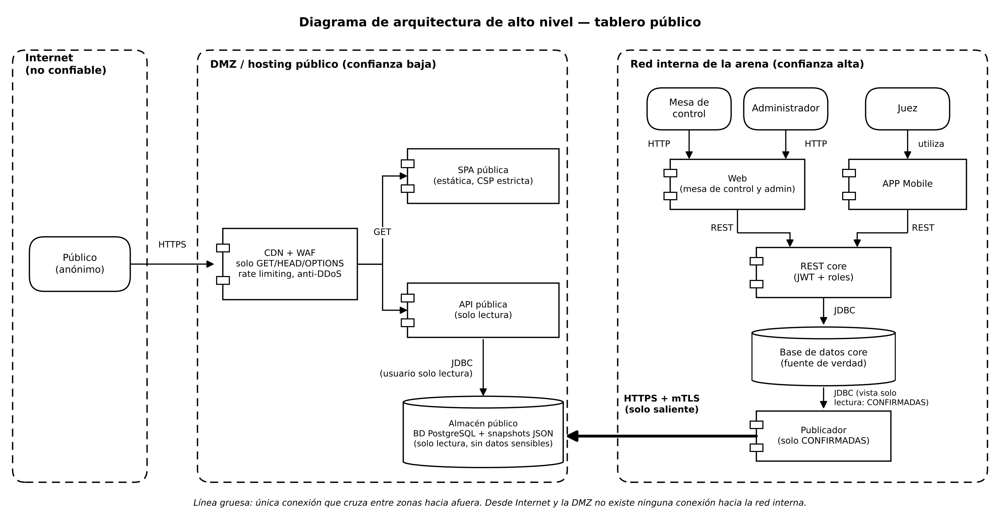
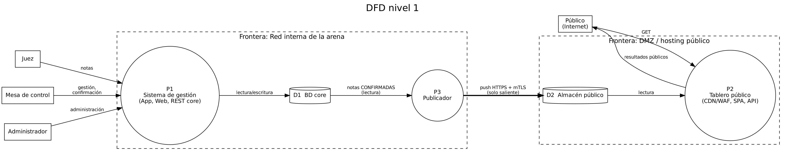
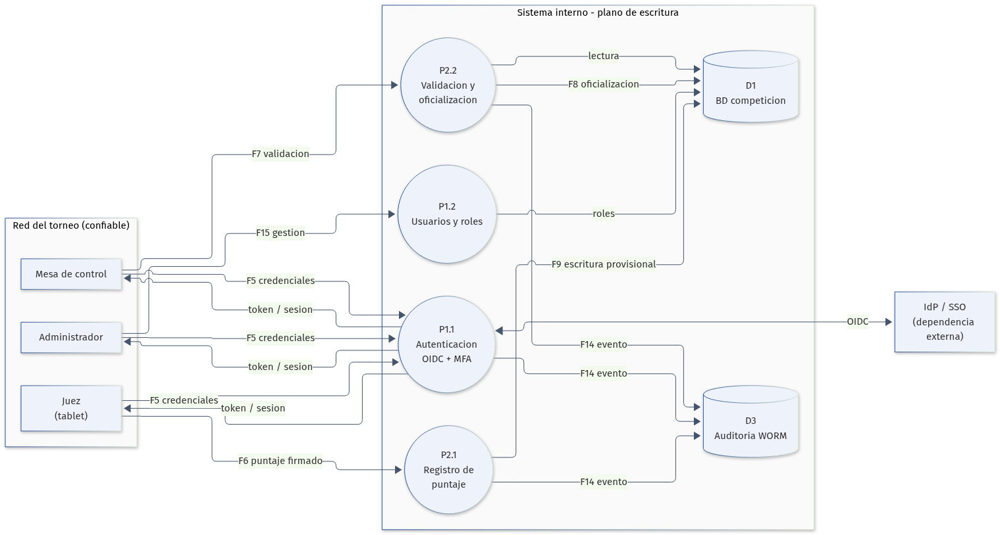
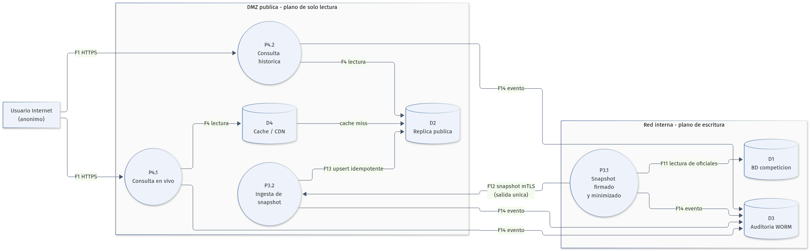

# Práctica 5: Diseño seguro

## Modelado de amenazas del tablero público de puntajes
**Curso:** Desarrollo de Software Seguro  
**Autores:** Lucía Iriarte y Ramiro López  
**Fecha:** Noviembre de 2026  

## Resumen
Con esta iteración la Federación suma un tablero público en Internet donde cualquiera puede ver los resultados en vivo y consultar torneos anteriores. A primera vista parece una función de lectura, pero en realidad cambia bastante la superficie de exposición. Por primera vez la aplicación queda accesible desde una red que no controlamos y los resultados de una competencia pasan a ser información pública.

El presidente de la Federación planteó su preocupación de que alguien desde Internet pueda modificar una nota. Nosotros lo abordamos desde la arquitectura y no solo con controles de aplicación. La propuesta separa el plano de escritura, donde se registran, validan y oficializan los puntajes, del plano de publicación, que es la consulta pública. El tablero se alimenta de una réplica de solo lectura mediante un flujo unidireccional de snapshots firmados. La DMZ pública no tiene ruta hacia la red interna, la API pública no implementa operaciones de escritura y el usuario de base de datos asociado solo puede ejecutar "SELECT". Aun si un atacante comprometiera el sitio o la API pública, no tendría un camino directo hacia la base de competición. La respuesta detallada a la preocupación del presidente está en la sección 2.6.

Para armar el modelo aplicamos el proceso OWASP que vimos en el teórico. Primero determinamos el alcance, después identificamos las amenazas con STRIDE, definimos las contramedidas y por último evaluamos el resultado. Identificamos 20 amenazas nuevas por el tablero público y reevaluamos 6 que venían de la iteración anterior. Los puntajes DREAD más altos, que son inherentes y se calculan antes de aplicar controles, son la exposición de datos personales en el tablero (8,6), la denegación de servicio durante el evento (8,6), la alteración de puntajes desde Internet (8,4) y la divulgación de información y elevación de privilegios (8,0). Todas quedan con riesgo residual bajo, salvo NT-11 (DDoS), que queda en 4,2 (medio) y se acepta formalmente con condiciones, responsable y revisión después del evento.

En resumen, el diseño permite publicar resultados en vivo sin comprometer la integridad de la competencia, protege los datos personales de gimnastas que pueden ser menores de edad y mantiene el torneo en marcha aunque el tablero público o la conexión a Internet fallen.

## 1. Contexto y alcance
### 1.1 El sistema y el cambio solicitado
La Federación deportiva opera un sistema de gestión de torneos que ya analizamos en el teórico. Los gimnastas se inscriben en categorías (P1 a P4 y AC1 a AC4), pueden representar a un club o competir en forma libre, y realizan una rutina en cada uno de los cuatro aparatos: viga, salto, barra y suelo. Cada rutina recibe un puntaje entre 0 y 99,999 con tres decimales.

En la versión analizada los jueces reciben una planilla, anotan la nota y la mesa de control la ingresa en la aplicación web. La nueva versión incorpora tablets para que los jueces ingresen directamente los puntajes. La iteración anterior del modelo de amenazas ya había identificado varios riesgos, entre ellos la suplantación de jueces, la modificación de puntajes, el repudio de una nota, la exposición de tokens JWT, la denegación de servicio y la elevación de privilegios por parte de la mesa de control o de un administrador.

El nuevo requerimiento agrega un tablero de puntajes público en Internet. Cualquier persona puede acceder a una URL y ver los resultados en vivo del torneo, y también puede consultar los resultados de torneos anteriores. El tablero tiene que ser transparente y equitativo, en línea con el principio deportivo de que cualquier interesado pueda conocer los puntajes. Además, el presidente de la Federación manifestó su preocupación por que alguien desde Internet modifique la nota de un gimnasta. El desarrollo de esta nueva versión todavía no comenzó, así que el modelado se hace en la etapa de diseño, que es el momento de menor costo para corregir decisiones estructurales.
### 1.2 Objetivos de negocio y requisitos

| ID | Objetivo | Implicancia de seguridad |
|---|---|---|
| ON-01 | Registrar puntajes de forma precisa y trazable, reduciendo errores humanos. | Integridad, auditoría y no repudio de cada registro. |
| ON-02 | Garantizar la integridad de los puntajes, evitando manipulaciones posteriores. | Control de acceso, firmas, versionado y registro inmutable. |
| ON-03 | Proteger la confidencialidad de los datos personales de gimnastas y jueces. | Minimización, clasificación y cumplimiento de la Ley 18.331. |
| ON-04 | Asegurar la disponibilidad del sistema durante las competencias. | Resiliencia, continuidad y desacoplamiento del tablero público. |
| ON-05 | Mantener la reputación de la Federación y la transparencia del torneo. | Resultados oficiales verificables y publicación controlada. |
| ON-06 | Publicar resultados en vivo y históricos para cualquier persona en Internet. | Nueva superficie de ataque, disponibilidad y privacidad. |

Los requisitos normativos y de negocio son tres. El primero es la Ley N.º 18.331 de Protección de Datos Personales y su decreto reglamentario, que exige un tratamiento legítimo, seguro y limitado a la finalidad de los datos de gimnastas y jueces. Como los gimnastas pueden ser menores de edad, el análisis tiene que ser más exigente. El segundo es el principio de transparencia y equidad deportiva, porque cualquier involucrado que lo solicite debe poder conocer los puntajes. El tercero es la disponibilidad durante el evento, ya que el tablero público no puede convertirse en una dependencia del registro de puntajes.
### 1.3 Supuestos y límites del análisis
1. El tablero publica únicamente resultados oficiales validados por la mesa de control. La expresión “en vivo” la interpretamos como una latencia menor a 60 segundos desde la oficialización y no como publicación instantánea de valores provisionales. Si el negocio exige mostrar valores provisionales, se van a mostrar con una marca visual y textual inequívoca y no se van a usar para rankings definitivos.
2. La Federación es la propietaria de las tablets de los jueces y aplica gestión de dispositivos (MDM). La red WiFi de la arena la controla la Federación y existe un SSID exclusivo para la aplicación, en una VLAN propia, al que el público no tiene acceso. Los jueces, la mesa de control y los administradores se autentican, mientras que el público no.
3. La Federación va a contratar un proveedor de CDN, WAF y protección anti-DDoS, y va a utilizar un proveedor de identidad (IdP). La base de competición no se expone directamente a Internet en ningún escenario.
4. Las correcciones de puntajes se hacen mediante una nueva versión o un asiento compensatorio, nunca eliminando el registro original en silencio. La publicación de resultados históricos se limita a datos deportivos y no incluye información de contacto, documentos ni datos de salud.
5. Quedan fuera de alcance el reglamento deportivo y el algoritmo de puntuación, la seguridad física del lugar más allá de la red WiFi, las aplicaciones de terceros que consuman los resultados, las apuestas deportivas y el tratamiento de imágenes o videos de gimnastas.
### 1.4 Activos a proteger
- **A-01** Puntajes oficiales y su historial de versiones (integridad crítica).
- **A-02** Identidades y credenciales de jueces, mesa y administradores (confidencial).
- **A-03** Datos personales de gimnastas, posiblemente menores, y jueces (confidencial y regulado).
- **A-04** Disponibilidad del sistema durante el torneo (disponibilidad crítica).
- **A-05** Reputación y credibilidad de la Federación (confidencial y reputacional).
- **A-06** Integridad del proceso de publicación (integridad crítica).
- **A-07** Infraestructura, secretos y claves de firma (restringido).
- **A-08** Registros de auditoría (restringido).
- **A-09** Disponibilidad y veracidad del tablero público (disponibilidad e integridad).
### 1.5 Criterios de riesgo y umbrales
Usamos DREAD para priorizar. El puntaje se calcula como el promedio de Daño (D), Reproducibilidad (R), Explotabilidad (E), Usuarios afectados (A) y Detectabilidad (D), en una escala de 1 a 10. El puntaje inicial de cada amenaza es inherente: se calcula antes de aplicar los controles propuestos. El riesgo residual, que se estima después de aplicarlos, se presenta en la sección 5.

**Prioridad inicial de la amenaza**

| Puntaje DREAD | Prioridad | Tratamiento exigido |
|---|---|---|
| 8,0 – 10,0 | Crítica | Mitigación obligatoria antes de salir a producción. No se acepta sin aprobación del dueño del negocio y del responsable de seguridad. |
| 7,0 – 7,9 | Alta | Mitigación obligatoria. Puede aceptarse un residual medio con plan y fecha. |
| 4,0 – 6,9 | Media | Mitigación planificada y seguimiento en el backlog. |
| Menor a 4,0 | Baja | Se acepta o se monitorea. |

**Nivel de riesgo residual**

| Residual | Nivel | Decisión |
|---|---|---|
| Menor a 4,0 | Bajo | Aceptable. |
| 4,0 – 5,9 | Medio | Requiere aceptación formal del dueño del proceso de negocio, con justificación, compensaciones y fecha de revisión. |
| 6,0 o más | Alto | Impide la salida a producción. |

DREAD es una herramienta de priorización y no una medida absoluta de probabilidad, así que lo complementamos con el contexto del negocio, el valor del activo y los controles compensatorios que ya existen.

## 2. Entregable 1:  Arquitectura propuesta
### 2.1 Vista de arquitectura

**Figura 1.** Vista lógica de alto nivel de la arquitectura propuesta. El plano de escritura permanece en la red interna y el plano de lectura pública se despliega en una DMZ sin ruta hacia la red interna. La publicación es un flujo unidireccional de snapshots firmados.

**Nota de lectura.** La Figura 1 es una vista lógica y no un mapa de reglas de firewall. El CDN/WAF se dibuja junto al hosting público por claridad, pero operativamente es un borde gestionado separado y semi-confiable. El Administrador se muestra en la red interna porque accede desde allí por VPN, la consola de administración reside en la red de gestión. El almacén público agrupa el receptor de publicación, la réplica y la caché. La sección 2.3 es la fuente de verdad para las zonas de confianza y las reglas de firewall.

La arquitectura mantiene el tablero público como un producto de datos derivado y no como una vista directa de la base de competición. Esto es lo que responde estructuralmente a la preocupación del presidente: desde Internet no existe una ruta de escritura hacia los puntajes, ni siquiera si un atacante compromete el sitio público.
### 2.2 Componentes y responsabilidades

| Componente | Zona | Responsabilidad | Controles principales |
|---|---|---|---|
| CDN + WAF + Anti-DDoS | Borde del proveedor | Terminación TLS, caché, filtrado de tráfico malicioso, mitigación DDoS. | TLS 1.3, WAF con OWASP CRS, solo GET/HEAD/OPTIONS, rate limiting, bot management, origin shield, autenticación de origen. |
| Sitio público (React SPA estática) | DMZ | Interfaz de consulta para el público. | Sin secretos, CSP estricta, SRI, source maps deshabilitados, build inmutable, cabeceras de seguridad. |
| API pública | DMZ | Consulta de resultados en vivo e históricos. | Solo GET, validación de esquema, paginación, ETag, errores genéricos, rol de base de datos SELECT únicamente. |
| Réplica pública / caché | DMZ | Almacena exclusivamente los datos publicables. | Solo datos derivados y minimizados, sin PII sensible, sin credenciales de escritura, refresco idempotente, hash verificable contra la fuente de verdad. |
| Receptor de publicación | DMZ | Recibe y valida los snapshots del publicador. | mTLS, verificación de firma JWS, control de secuencia y frescura, idempotencia, auditoría. |
| Servicio de publicación | Red interna | Lee resultados oficiales, minimiza, agrega y firma snapshots. | Outbox/CDC, whitelist de campos, firma Ed25519, salida únicamente, reintentos idempotentes, reconciliación periódica de hashes con la réplica (consulta saliente). |
| API interna (Spring) | Red interna | Registro, validación y oficialización de puntajes. | OIDC, RBAC/ABAC, validación de rango, idempotencia, máquina de estados, auditoría. |
| IdP / SSO | Red interna | Autenticación de jueces, mesa y administradores. | OIDC, MFA, tokens de corta duración, claims de dispositivo, políticas de acceso condicional. |
| PostgreSQL primaria | Red interna | Fuente de verdad de la competición. | Subred privada, cifrado en reposo, sin Internet, usuarios de mínimo privilegio, backups. |
| App Android de jueces | Red interna (WiFi del torneo) | Ingreso de puntajes desde tablets. | MDM, certificado de dispositivo/mTLS, certificate pinning, cola offline cifrada, sin logs de puntajes, borrado remoto. |
| SPA de mesa de control | Red interna | Validación y oficialización de puntajes. | Acceso solo desde red interna/VPN, OIDC, MFA, RBAC, sesión corta. |
| Consola de administración | Red de gestión | Administración de usuarios, roles y configuración. | VPN, PAM, MFA, acceso just-in-time, lista de IP permitidas, sin exposición a Internet. |
| SIEM / logs WORM | Red interna | Centralización y retención inmutable de auditoría. | Hash chain, WORM, alertas, retención, control de acceso, recolección iniciada desde la red interna. |
| Backups y KMS / Secrets Manager | Red de gestión (cuenta/región separada) | Recuperación ante desastre y custodia de claves y secretos. | Cifrado, inmutabilidad, pruebas de restauración, rotación, auditoría, credenciales efímeras. |
| CI/CD | Red de gestión | Construcción y despliegue seguro. | SAST, DAST, SCA, SBOM, artefactos firmados, IaC scanning, aprobaciones. |
### 2.3 Zonas de confianza y segmentación de red

Las zonas que definimos son cinco. Internet es no confiable. El borde gestionado (CDN, WAF y anti-DDoS del proveedor) es semi-confiable. La DMZ pública es de confianza baja y no tiene ruta hacia la red interna. La red interna del torneo es de confianza alta e incluye los servidores y la WiFi con SSID exclusivo, en una VLAN propia, donde operan las tablets. La red de gestión también es de confianza alta, pero con acceso separado mediante VPN, PAM y MFA, e incluye las cuentas separadas de backups y claves.

Las reglas de firewall más importantes son estas. Internet hacia el CDN solo por 443/TCP. Del CDN a la DMZ con autenticación de origen. De la DMZ a la red interna, denegado por completo: la DMZ nunca inicia conexiones hacia la red interna. De la red interna a la DMZ solo dos orígenes: el servicio de publicación, por 443/TCP, con mTLS y salida unidireccional, y el colector del SIEM, que inicia la recolección de los logs de la DMZ por un canal dedicado con mTLS y de solo lectura. De la red interna a Internet solo por un proxy de salida con allowlist.
### 2.4 Dependencias externas

| ID | Dependencia | Descripción | Control esperado |
|---|---|---|---|
| DE-01 | Proveedor CDN/WAF/Anti-DDoS | Borde de Internet, caché y mitigación DDoS. | Contrato con SLA, MFA, registro de cambios, origin shield, revisión de configuración. |
| DE-02 | DNS público y autoridad certificadora | Resolución y certificados TLS. | DNSSEC, CAA, registrar lock, MFA en el registrador, monitoreo de Certificate Transparency. |
| DE-03 | Internet / ISP de la arena | Conectividad del público y de la red del torneo. | Enlaces redundantes, monitoreo, plan de contingencia. |
| DE-04 | IdP / SSO | Autenticación de operadores. | OIDC, MFA, políticas de acceso condicional, revisión de accesos. |
| DE-05 | PostgreSQL | Motor de base de datos. | Versión soportada, parches, cifrado, backups, monitoreo. |
| DE-06 | Tablets Android y MDM | Dispositivos de los jueces. | MDM, cifrado, bloqueo, borrado remoto, inventario, actualizaciones. |
| DE-07 | KMS / Secrets Manager | Custodia de claves y secretos. | Rotación, separación de funciones, auditoría. |
| DE-08 | SIEM / almacenamiento WORM | Auditoría y detección. | Retención, inmutabilidad, alertas, control de acceso. |
| DE-09 | CI/CD y registro de artefactos | Construcción y despliegue. | SAST/DAST/SCA, SBOM, firma, aprobaciones, segregación de ambientes. |
| DE-10 | Almacenamiento de backups | Recuperación. | Cifrado, inmutabilidad, cuenta separada, pruebas de restauración. |

### 2.5 Puntos de entrada y niveles de confianza

| ID | Punto de entrada | Descripción | Protocolo / autenticación | Nivel de confianza |
|---|---|---|---|---|
| EP-01 | HTTPS público | URL del tablero público. | HTTPS 443, anónimo. | N0 |
| EP-02 | API pública | Endpoints /api/public/*. | HTTPS, solo GET, anónimo. | N0 |
| EP-03 | Sitio estático | Recursos del front público. | HTTPS, anónimo. | N0 |
| EP-04 | API interna | Endpoints de registro y administración. | HTTPS + OIDC + mTLS, jueces, mesa y admin. Solo desde la red interna o VPN. | N2, N3, N4 |
| EP-05 | App Android | Aplicación de jueces. | mTLS + OIDC + firma de dispositivo. | N2 |
| EP-06 | SPA de mesa de control | Validación y oficialización. | OIDC + MFA, solo red interna/VPN. | N3 |
| EP-07 | Consola de administración | Gestión de usuarios, roles y configuración. | VPN + PAM + MFA + JIT. | N4 |
| EP-08 | Ingesta de publicación | Recepción de snapshots en el Receptor de la DMZ. | mTLS + JWS. Acepta únicamente conexiones del Servicio de publicación (allowlist de origen). | N5 |
| EP-09 | CI/CD | Despliegue de artefactos. | OIDC federado, aprobaciones, artefactos firmados. | N5 |
| EP-10 | Monitoreo / SIEM | Recolección de logs y métricas. | mTLS, credenciales de servicio. La recolección la inicia el SIEM desde la red interna. | N5 |

Los niveles de confianza son: N0 anónimo de Internet, N1 anónimo de red local, N2 juez, N3 mesa de control, N4 administrador y N5 servicio.

### 2.6 Respuesta a la preocupación del presidente
**¿Puede alguien, desde Internet, modificar la nota de un gimnasta?** No, y no depende de un único control. Para alterar un puntaje oficial desde Internet habría que atravesar, en este orden, siete barreras independientes:

1. **CDN/WAF:** solo permite GET, HEAD y OPTIONS, con rate limiting y filtrado de tráfico malicioso.
2. **API pública:** no implementa operaciones de escritura, y valida el esquema de cada parámetro.
3. **Base de datos de la réplica:** el usuario de la API solo puede ejecutar SELECT.
4. **Réplica separada:** lo que se consulta no es la base de competición, sino una copia derivada y minimizada.
5. **Segmentación:** la DMZ no tiene ruta hacia la red interna y el firewall deniega por defecto las conexiones entrantes.
6. **Sin credenciales del core en la DMZ:** quien comprometa la capa pública no encuentra nada con qué autenticarse contra el core.
7. **El core:** exige OIDC, MFA, mTLS y control de acceso por roles, y solo es accesible desde la red interna o la VPN.

Además, aun si se lograra alterar la copia pública, la reconciliación periódica de hashes contra la fuente de verdad lo detecta, los snapshots firmados no se pueden reemplazar sin la clave del servicio de publicación, y la copia se reconstruye desde el core. La fuente de verdad nunca se modifica.

## 3. Entregable 2 : Paso 1: Determinar el alcance
### 3.1 Proceso OWASP aplicado
Aplicamos el proceso de cuatro pasos que vimos en el teórico. El primero es determinar el alcance, donde describimos el sistema, el nuevo requerimiento, los activos, las dependencias, los puntos de entrada, los niveles de confianza y los DFD. El segundo es determinar las amenazas, analizando cada componente y flujo con STRIDE y calculando DREAD. El tercero es determinar las contramedidas y mitigaciones, eligiendo el tratamiento (aceptar, eliminar, mitigar o transferir), definiendo los controles y estimando el riesgo residual. El cuarto es evaluar el análisis, verificando si quedan riesgos por encima del umbral, documentando las excepciones y planificando la siguiente iteración.

Este documento es la segunda iteración del modelo. La primera cubrió el sistema de gestión de torneos con tablets para jueces, y esta incorpora el tablero público en Internet y revisa las amenazas heredadas con la nueva exposición.
### 3.2 DFD nivel 1

**Figura 2.** DFD nivel 1. Se incorporan los procesos de publicación y consulta pública, y la réplica pública como almacén separado de la base de competición.
### 3.3 DFD nivel 2: registro y validación de puntajes

**Figura 3.** DFD nivel 2 del plano de escritura. La autenticación, el registro y la oficialización ocurren en la red interna, y la mesa de control valida antes de que un resultado pueda publicarse.
### 3.4 DFD nivel 2: publicación y consulta

**Figura 4.** DFD nivel 2 del plano de lectura. El publicador envía un snapshot firmado a la DMZ y la consulta pública solo lee la réplica y la caché.

Los flujos nuevos son seis: F1 Usuario Internet hacia CDN, F2 CDN hacia Sitio público, F3 CDN/front hacia API pública, F4 API pública hacia réplica/caché, F12 Publicador hacia receptor DMZ y F13 Receptor hacia réplica pública. Los flujos F5 a F11 y F14 a F17 corresponden al plano interno y se mantienen de la iteración anterior. La tabla 3.5 los detalla.
### 3.5 Flujos de datos

| ID | Origen → Destino | Datos | Frontera cruzada | Origen |
|---|---|---|---|---|
| F1 | Usuario de Internet → CDN/WAF | Requests HTTPS GET (torneos, resultados) | Internet → borde | Nuevo |
| F2 | CDN/WAF → Sitio público | Contenido estático (HTML, JS, CSS) | Borde → DMZ | Nuevo |
| F3 | CDN/WAF, front → API pública | Consultas de resultados (solo GET) | Borde → DMZ | Nuevo |
| F4 | API pública ↔ Réplica pública / caché | Consultas de lectura y resultados (usuario SELECT) | Interna de la DMZ | Nuevo |
| F5 | App Android → IdP / SSO | Autenticación OIDC del juez (credenciales, MFA, certificado de dispositivo) | Interna | Heredado |
| F6 | App Android → API interna | Ingreso de puntajes con token JWT (mTLS) | Interna | Heredado |
| F7 | SPA de mesa de control → API interna | Validación, corrección y oficialización de puntajes | Interna | Heredado |
| F8 | API interna ↔ PostgreSQL primaria | Lectura y escritura de puntajes y versiones | Interna | Heredado |
| F9 | API interna → PostgreSQL primaria | Escritura provisional del puntaje antes de la oficialización | Interna | Heredado |
| F10 | API interna ↔ IdP / SSO | Validación de tokens y claims | Interna | Heredado |
| F11 | PostgreSQL primaria → Servicio de publicación | Lectura de puntajes oficiales (outbox/CDC, vista de solo lectura) | Interna | Heredado |
| F12 | Servicio de publicación → Receptor de publicación | Snapshot firmado con secuencia y hash (HTTPS + mTLS, solo saliente) | Red interna → DMZ | Nuevo |
| F13 | Receptor de publicación → Réplica pública | Escritura idempotente del snapshot validado | Interna de la DMZ | Nuevo |
| F14 | Servicios internos → SIEM | Eventos de auditoría de la API, del publicador y del receptor | Interna | Heredado |
| F15 | Consola de administración → API interna | Gestión de usuarios, roles y configuración | Red de gestión → interna | Heredado |
| F16 | CI/CD → Entornos | Despliegue de artefactos firmados | Red de gestión → entornos | Heredado |
| F17 | PostgreSQL primaria → Backups / KMS | Copias cifradas y claves | Interna → gestión | Heredado |

## 4. Paso 2: Determinar amenazas
### 4.1 Método
Para cada elemento y flujo del DFD aplicamos las seis categorías STRIDE: S Spoofing, T Tampering, R Repudiation, I Information Disclosure, D Denial of Service y E Elevation of Privilege. Cada amenaza se puntúa con DREAD y se clasifica según la tabla de la sección 1.5. El puntaje es inherente, es decir, se calcula antes de aplicar los controles propuestos: por eso la modificación de una nota desde Internet figura con un puntaje alto, aunque el diseño elimina ese vector. El efecto de los controles se refleja en el riesgo residual de la sección 5. Las amenazas nuevas llevan el prefijo NT y las heredadas el prefijo HR.
### 4.2 Amenazas del nuevo requerimiento

| ID | STRIDE | Amenaza / escenario | Elemento o flujo | D/R/E/A/D | Puntaje | Prioridad |
|---|---|---|---|---|---|---|
| NT-01 | T | Un atacante desde Internet intenta escribir o alterar un puntaje usando la superficie pública. Prueba PUT/PATCH/DELETE, manipula identificadores, aprovecha mass assignment o una inyección en filtros de la API pública. | EP-02, F3, F4 | 10/8/6/10/8 | 8,4 | Crítica |
| NT-02 | T | Envenenamiento de caché o compromiso de una cuenta del proveedor CDN para mostrar resultados falsos o alterar los publicados. | CDN, F2, F3 | 9/6/4/10/5 | 6,8 | Media |
| NT-03 | T | Alteración del snapshot en tránsito entre el publicador interno y el receptor de la DMZ mediante MITM, replay o reemplazo del mensaje. | F12 | 9/5/4/10/5 | 6,6 | Media |
| NT-04 | T | Publicación de resultados provisionales o no validados, difundiendo un error o una manipulación como si fuera oficial. | F11, F12, F13 | 7/8/6/10/7 | 7,6 | Alta |
| NT-05 | S | Suplantación del sitio público mediante secuestro de DNS, typosquatting o phishing para difundir resultados falsos o robar credenciales de jueces. | DNS, CDN, EP-01 | 8/5/5/10/6 | 6,8 | Media |
| NT-06 | S | Suplantación de un juez por un atacante ubicado en la WiFi o en la red local de la arena (N1), con credenciales robadas u obtenidas por phishing, o con una tablet perdida o robada. | F5, F6, EP-04, EP-05 | 10/7/6/8/7 | 7,6 | Alta |
| NT-07 | S | Un servicio malicioso se presenta ante el receptor de la DMZ como el publicador legítimo y envía snapshots falsos. | EP-08, F12 | 9/5/4/10/5 | 6,6 | Media |
| NT-08 | I | Exposición de datos personales de gimnastas, posiblemente menores, o de jueces en el tablero: nombres completos, documentos, fechas de nacimiento, contactos, escuela o datos de salud. | EP-02, F4 | 8/10/9/10/6 | 8,6 | Crítica |
| NT-09 | I | Divulgación de información interna por errores verbosos, source maps, Actuator/Swagger expuestos, metadatos, identificadores internos o endpoints de administración. | Sitio público, API pública | 7/8/8/10/7 | 8,0 | Crítica |
| NT-10 | I | Scraping o enumeración masiva de resultados históricos y construcción de perfiles de gimnastas. | EP-02, F1, F4 | 2/10/10/6/10 | 7,6 | Alta |
| NT-11 | D | DDoS o HTTP flood contra el tablero público durante una competencia, afectando la disponibilidad y la reputación. | CDN, EP-01, EP-02 | 5/9/9/10/10 | 8,6 | Crítica |
| NT-12 | D | Agotamiento de recursos mediante paginación abusiva, ordenamientos costosos, búsquedas con comodines o exportaciones masivas en la API pública. | API pública, F4 | 3/10/10/7/9 | 7,8 | Alta |
| NT-13 | E | Pivote desde la DMZ comprometida hacia la red interna para afectar el registro de puntajes. | Segmentación DMZ/interna | 10/4/3/10/4 | 6,2 | Media |
| NT-14 | E | Elevación de privilegios en la API interna: un atacante en la red local (N1) o un usuario de menor nivel (juez) accede a funciones de mesa o de administración por validación deficiente de JWT, roles confiados al cliente, IDOR/BOLA o mass assignment. | API interna, EP-04, F6, F7 | 9/7/6/10/8 | 8,0 | Crítica |
| NT-15 | E | Compromiso del servicio de publicación (que custodia la clave de firma) o del receptor, que permite emitir snapshots falsos con firma válida o escribir directamente en la réplica pública. | F12, F13 | 10/4/3/10/4 | 6,2 | Media |
| NT-16 | E | Cadena de suministro comprometida: dependencia npm/Maven, imagen base o JavaScript de terceros que ejecuta código en el front o en la API. | CI/CD, front, API | 10/5/4/10/6 | 7,0 | Alta |
| NT-17 | R | Un juez, la mesa o un operador niega haber registrado, corregido o publicado un resultado, sin evidencia suficiente para acreditarlo. | F6, F7, F12, F14 | 7/7/5/6/4 | 5,8 | Media |
| NT-18 | E | Exposición accidental de la consola de administración a Internet por un error de configuración (regla de firewall, DNS o balanceador), quedando sujeta a fuerza bruta, credential stuffing o explotación de vulnerabilidades. | EP-07, F15 | 10/6/5/10/7 | 7,6 | Alta |
| NT-19 | I | Fuga de secretos, como claves de base de datos, del CDN o de firma, en repositorios, imágenes, front o logs de CI. | CI/CD, KMS, front | 9/7/6/10/6 | 7,6 | Alta |
| NT-20 | D | Acoplamiento entre el tablero público y el registro de puntajes: la caída o la carga del tablero afecta la operación del torneo. | Arquitectura, F4, F8 | 10/5/4/10/4 | 6,6 | Media |

### 4.3 Reevaluación de amenazas heredadas

| ID | Amenaza heredada | DREAD (previo → revisado) | Efecto del nuevo requerimiento | Control adicional | Residual |
|---|---|---|---|---|---|
| HR-01 | Un atacante intenta iniciar sesión como un juez. | 8,2 → 8,2 | Se mantiene. El core sigue accesible solo desde la red interna (supuesto crítico), pero el tablero público aumenta el valor reputacional de suplantar a un juez. | MFA resistente a phishing, certificado de dispositivo, acceso condicional, bloqueo y monitoreo. | 2,4 |
| HR-02 | Un atacante o insider modifica un puntaje. | 6,8 → 6,8 | Se mantiene. El tablero público no escribe, pero aumenta el incentivo reputacional. | RBAC, separación de funciones, doble control, auditoría y revisión. | 2,8 |
| HR-03 | Un juez no reconoce el puntaje como suyo. | 6,8 → 6,8 | Se mantiene. La publicación hace más visible el resultado y el reclamo. | Firma de dispositivo, identidad, sello de tiempo y auditoría WORM. | 2,4 |
| HR-04 | Un atacante visualiza un token JWT. | 8,6 → 8,6 | Se mantiene. Los tokens circulan solo dentro de la red interna y nunca llegan a la capa pública. | Tokens cortos, refresh rotation, mTLS, pinning, no logs y revocación. | 2,8 |
| HR-05 | Un atacante envía miles de pedidos al servicio REST. | 6,0 → 5,2 | Disminuye para la API interna porque no está expuesta a Internet y el DDoS se absorbe en el borde. | Rate limiting, WAF, cuotas y monitoreo. | 3,2 |
| HR-06 | El administrador o la mesa de control ingresan un puntaje. | 6,2 → 6,2 | Se mantiene. La publicación agrega presión sobre la trazabilidad. | RBAC/ABAC, separación de funciones, auditoría y revisión de permisos. | 2,6 |

## 5. Paso 3: Determinar contramedidas y mitigaciones
### 5.1 Estrategia de tratamiento

| Tratamiento | Amenazas | Fundamento |
|---|---|---|
| **Eliminar** | NT-18, NT-20 (parcial) | Se elimina la exposición de la consola administrativa y se desacopla el tablero del scoring. |
| **Mitigar** | NT-01 a NT-17, NT-19, NT-20 (parcial), HR-01 a HR-06 | Controles técnicos y organizativos que reducen la probabilidad o el impacto. En NT-02, NT-05, NT-10 y NT-11 se combina con transferencia o aceptación. |
| **Transferir** | NT-02, NT-05, NT-11 (parcial) | Se comparte el riesgo con el proveedor de CDN/WAF mediante contrato, SLA y seguro. La Federación retiene la responsabilidad reputacional. |
| **Aceptar** | NT-10, NT-11 (residual) | Los resultados son públicos por requisito de negocio. El residual de DDoS se acepta con condiciones y plan de continuidad. |
### 5.2 Contramedidas por amenaza

| ID | Tratamiento | Contramedida | Implementación concreta | Residual |
|---|---|---|---|---|
| NT-01 | Mitigar | API pública sin escritura y base de datos de solo lectura. | No desplegar rutas de escritura en la API pública, usar rol SELECT sobre la réplica, separar el esquema, aplicar WAF (solo GET, HEAD y OPTIONS) y validación de esquema, y probar verbos, IDOR y mass assignment. | 2,6 |
| NT-02 | Mitigar / transferir | Endurecer la caché y el proveedor CDN. | Normalizar claves de caché, ignorar Host y X-Forwarded-* no confiables, usar origin shield y purgas firmadas, exigir MFA y registro de cambios en el proveedor, TTL corto y hash de contenido. | 3,2 |
| NT-03 | Mitigar | Canal firmado y resistente a replay. | mTLS, JWS con Ed25519, nonce, secuencia y sello de tiempo, ventana de frescura, rechazo de replay, pinning y enlace privado. | 2,2 |
| NT-04 | Mitigar | Máquina de estados y publicación solo de oficiales. | Estados provisional, validado y oficial. La API pública solo consulta oficiales, las correcciones requieren doble control, y hay versionado, rollback y asiento compensatorio. | 2,8 |
| NT-05 | Mitigar / transferir | Proteger dominio, DNS y marca. | DNSSEC, CAA, registrar lock, MFA en el registrador, monitoreo de Certificate Transparency, HSTS preload, monitoreo de marca, takedown y security.txt. | 3,8 |
| NT-06 | Mitigar | Autenticación fuerte y binding de dispositivo. | MFA resistente a phishing, certificado de dispositivo/mTLS, SSID exclusivo con VLAN propia y 802.1X, acceso condicional por dispositivo, red y geografía, bloqueo, sesión corta, borrado remoto por MDM y monitoreo de imposible travel. | 2,6 |
| NT-07 | Mitigar | Identidad de servicio y verificación criptográfica. | mTLS con CA interna, identidad de servicio, JWS, allowlist de publicadores, rotación de claves y mínimo privilegio. | 2,2 |
| NT-08 | Mitigar | Minimización y privacidad desde el diseño. | Whitelist de campos, sin documento, nacimiento, contacto, domicilio, salud ni nombres de jueces, nombre de menores solo con consentimiento del tutor (de lo contrario, número de competidor), DPIA, base legal, retención, procedimiento de supresión y derechos de acceso y rectificación (ver 5.3). | 3,6 |
| NT-09 | Mitigar | Endurecer errores y configuración. | Errores genéricos, desactivar debug, Actuator y Swagger públicos, sin source maps, cabeceras de seguridad, logs sin secretos y consola de administración separada. | 2,4 |
| NT-10 | Aceptar / mitigar | Límites de uso y transparencia. | Rate limiting y bot management, paginación máxima, términos de uso, monitoreo, aceptar que los resultados son públicos y no agregar PII adicional. | 3,8 |
| NT-11 | Mitigar / transferir | Borde resiliente y continuidad. | CDN anycast con anti-DDoS, WAF, rate limiting, autoscaling, caché, fallback estático, runbook, SLA y seguro del proveedor. | 4,2 |
| NT-12 | Mitigar | Consultas acotadas y eficientes. | Máximo de página, paginación por keyset, campos de orden permitidos, índices, timeout, caché, réplica dedicada y cuotas por IP. | 3,0 |
| NT-13 | Mitigar | Segmentación estricta. | Sin ruta DMZ hacia interna, security groups, egress deny, VPC y cuentas separadas, mínimo privilegio y monitoreo de conexiones. | 1,8 |
| NT-14 | Mitigar | Autorización centralizada y validación de tokens. | Validar firma, alg, iss, aud, exp y nbf, RBAC/ABAC en servidor, control por objeto, denegar por defecto, no confiar en roles del cliente, API interna accesible solo desde la red interna o VPN y pruebas de IDOR/BOLA. | 2,4 |
| NT-15 | Mitigar | Limitar el valor del publicador y del receptor, y detectar alteraciones. | Snapshot mínimo, sin credenciales internas en la DMZ, flujo unidireccional, mTLS, firma con clave en KMS, host dedicado, imagen inmutable, sin shell, monitoreo y reconciliación periódica de hashes entre la fuente de verdad y la réplica, con alerta ante diferencias. | 1,8 |
| NT-16 | Mitigar | Cadena de suministro verificable. | Lockfiles, SCA y SBOM, firmas y procedencia (Sigstore), SRI, evitar JavaScript de terceros, registry privado, CSP y revisión de dependencias. | 3,4 |
| NT-17 | Mitigar | Auditoría y no repudio. | Registro WORM con quién, qué, cuándo, dónde y dispositivo, hash chain, firma, NTP, retención y revisión periódica. | 2,2 |
| NT-18 | Eliminar | Sacar la administración de Internet y detectar errores de configuración. | VPN + PAM + MFA + lista de IP + acceso just-in-time, sin DNS público, plano de gestión separado, registro de sesiones, infraestructura como código con revisión y escaneo periódico de puertos expuestos. | 1,2 |
| NT-19 | Mitigar | Gestión de secretos. | Secrets manager, escaneo de repositorios, imágenes y logs, rotación, credenciales efímeras, KMS, mínimo privilegio y auditoría. | 2,4 |
| NT-20 | Eliminar / mitigar | Desacoplar el tablero del scoring. | Infraestructura separada, réplica, bulkhead, cuotas, circuit breaker, despliegue independiente y prueba de caos. | 1,8 |
| HR-01 a HR-06 | Mitigar | Controles heredados reforzados. | MFA y certificado de dispositivo, RBAC/ABAC y doble control, firma y sello de tiempo, tokens cortos y refresh rotation, rate limiting, auditoría y revisión de permisos. | 2,4 a 3,2 |

### 5.3 Privacidad y protección de datos
El tablero público aumenta el tratamiento de datos personales y los expone a una audiencia indeterminada. La Ley 18.331 exige finalidad legítima, proporcionalidad, seguridad y transparencia. La publicación de resultados deportivos puede ampararse en el interés legítimo o en el consentimiento, pero no habilita a publicar cualquier dato. Los gimnastas pueden ser menores, así que aplicamos un criterio de minimización reforzado.

Por defecto publicamos número de competidor, club, categoría, aparato, puntaje, ranking, torneo, fecha y estado oficial. El nombre y apellido se publican solo cuando el gimnasta es mayor de edad o cuando hay consentimiento del tutor, con revisión legal; en los demás casos el gimnasta se identifica únicamente por su número de competidor. El riesgo residual de NT-08 asume este criterio. No publicamos fecha de nacimiento, documento, domicilio, teléfono, correo, escuela, datos de salud, nombres de jueces, identificadores internos, registros de auditoría ni fotografías o video.

Las medidas de privacidad que proponemos son las siguientes. Hacer una DPIA antes de la salida a producción. Documentar la base legal y ofrecer un aviso de privacidad accesible desde el tablero. Definir una política de retención, con históricos según el reglamento deportivo, auditoría según la obligación legal y datos de contacto fuera del tablero. Firmar acuerdos de tratamiento con el proveedor de CDN y el IdP, y evaluar las transferencias internacionales. Revisar la publicación de menores con el responsable de privacidad y, si corresponde, con las familias. Llevar un registro de actividades de tratamiento y designar un responsable.

**Derechos de acceso, rectificación, actualización y supresión.** Se habilita un canal y un plazo para ejercerlos. Como los snapshots son inmutables y están firmados, la supresión o rectificación de un dato ya publicado se resuelve emitiendo un snapshot sustituto con el dato redactado y una nueva firma, purgando la caché del CDN y registrando la baja en el log de auditoría sin el dato. Los backups se depuran según su ciclo de retención.
### 5.4 Riesgos residuales y aceptación

| ID | Amenaza | Residual | Nivel | Decisión | Condiciones |
|---|---|---|---|---|---|
| NT-11 | DDoS contra el tablero. | 4,2 | Medio | Aceptar / transferir | SLA del proveedor, runbook, caché, fallback estático, seguro y revisión posterior al evento. |
| NT-10 | Scraping y perfilado. | 3,8 | Bajo | Aceptar / mitigar | Rate limiting, bot management, términos de uso y monitoreo. Los datos son públicos por diseño. |
| NT-05 | Suplantación del sitio público. | 3,8 | Bajo | Aceptar / mitigar | Monitoreo de dominio y marca, DNSSEC, HSTS preload y takedown. |
| NT-08 | Exposición de datos personales. | 3,6 | Bajo | Mitigar | DPIA aprobada, criterio de publicación de nombres definido y whitelist de campos verificada antes de publicar. |
| Resto | — | ≤ 3,4 | Bajo | Mitigar | Verificación en la salida a producción. |

**Aceptación formal de NT-11.** La aceptación la firman el dueño del proceso de negocio (el presidente de la Federación o su delegado) y el responsable de seguridad, antes de la salida a producción. La revisión del riesgo se hace dentro de los 30 días posteriores al primer torneo con el tablero en vivo.

**Condición de salida a producción:** no se podrá publicar el tablero si alguna amenaza conserva un residual mayor o igual a 6,0 (alto), si una amenaza crítica conserva un residual medio (4,0 a 5,9) sin aceptación formal firmada por el dueño del negocio y el responsable de seguridad, si la DPIA no está aprobada o si no se ejecutaron las pruebas de segmentación, autorización y restauración. La aceptación de NT-11 con residual 4,2 cumple esta condición una vez firmada, con las condiciones y la fecha de revisión indicadas.

## 6. Paso 4: Evaluar el análisis y próximos pasos
### 6.1 Evaluación de las cuatro preguntas

| Pregunta del Threat Modeling Manifesto | Respuesta |
|---|---|
| ¿Qué estamos haciendo? | Publicar resultados oficiales de torneos en un tablero de Internet, en vivo y con históricos, sin exponer el plano de escritura. |
| ¿Qué puede salir mal? | Alteración de puntajes, suplantación de jueces, exposición de datos de menores, DDoS, divulgación de información, elevación de privilegios y fallas de disponibilidad. |
| ¿Qué vamos a hacer al respecto? | Aislar planos, publicar snapshots firmados, autenticar fuerte, autorizar en servidor, minimizar datos, auditar, proteger el borde y desacoplar la disponibilidad. |
| ¿Hicimos un trabajo suficientemente bueno? | Se cubrieron los componentes y flujos del DFD. El único residual medio (NT-11) queda aceptado formalmente con condiciones y dos residuales bajos (NT-05 y NT-10) quedan monitoreados. Persisten temas abiertos para la próxima iteración. |

Vamos a validar el modelo con revisión de arquitectura y segmentación, pruebas de penetración externa y autenticada, SAST/DAST/SCA, prueba de carga y DDoS, prueba de caos, restauración de backups, prueba de reconciliación ante alteración de la réplica, DPIA y simulacro de incidente. Los temas abiertos para la próxima iteración son la publicación de resultados provisionales, la API para terceros, las apuestas deportivas, el histórico anterior al sistema, las fotografías y videos, la accesibilidad, los cambios normativos y un esquema de transparencia verificable.

## 7. Conclusiones
El tablero público no es una simple pantalla de consulta. Es un nuevo producto de datos que expone el sistema a Internet y convierte los resultados en información pública. La respuesta de diseño correcta no consiste en agregar un login al tablero ni en confiar en que nadie va a intentar modificarlo, sino en separar el plano de escritura del plano de publicación y en hacer que el camino desde Internet hacia los puntajes sea inexistente por arquitectura.

La propuesta cumple el nuevo requerimiento de negocio, con resultados en vivo e históricos para cualquier persona, y responde a la preocupación del presidente. La API pública no escribe, la base pública es una réplica minimizada y de solo lectura, y la DMZ no tiene ruta hacia la red interna. La integridad se refuerza con autenticación fuerte, binding de dispositivo, autorización en servidor, auditoría inmutable, snapshots firmados y reconciliación de hashes. La privacidad se protege con minimización, whitelist de campos, DPIA y cumplimiento de la Ley 18.331. La disponibilidad se sostiene con CDN/WAF, caché, fallback y desacoplamiento del scoring.

El modelo identificó 20 amenazas nuevas y reevaluó 6 heredadas. Las amenazas críticas tienen controles definidos y residuales bajos. El único residual medio (NT-11) se acepta formalmente con condiciones, responsable y revisión, y los residuales bajos quedan monitoreados. El resultado es un diseño que se puede implementar, verificar y volver a modelar en la próxima iteración, tal como exige un proceso de threat modeling continuo.
